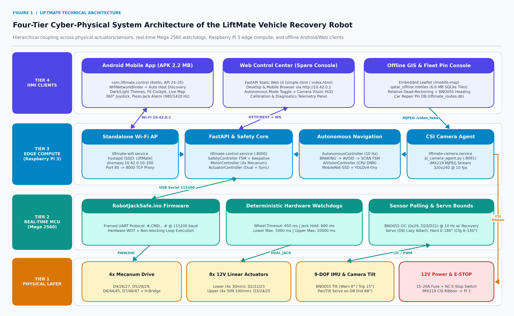
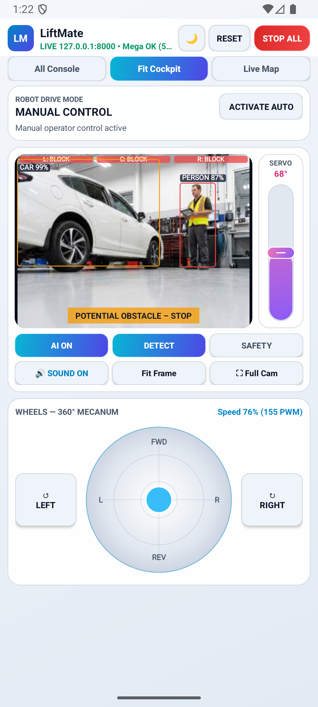
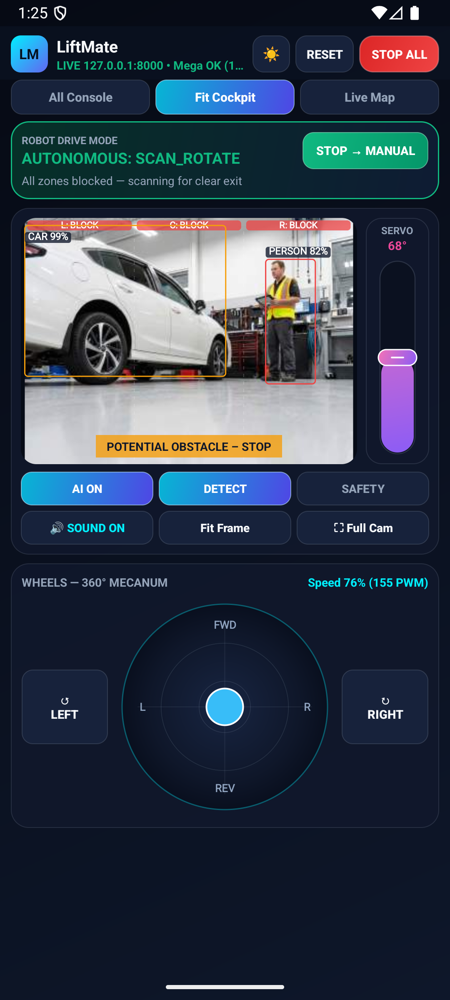
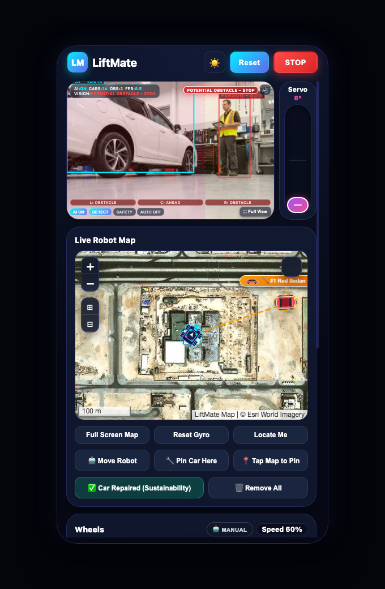
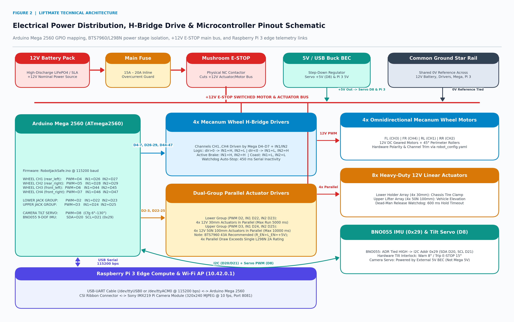
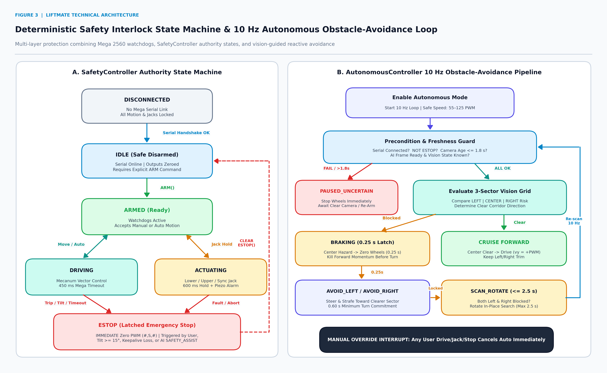
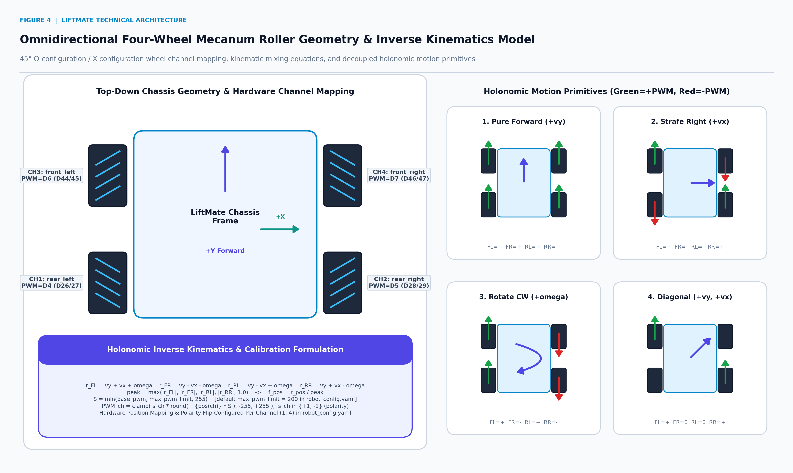
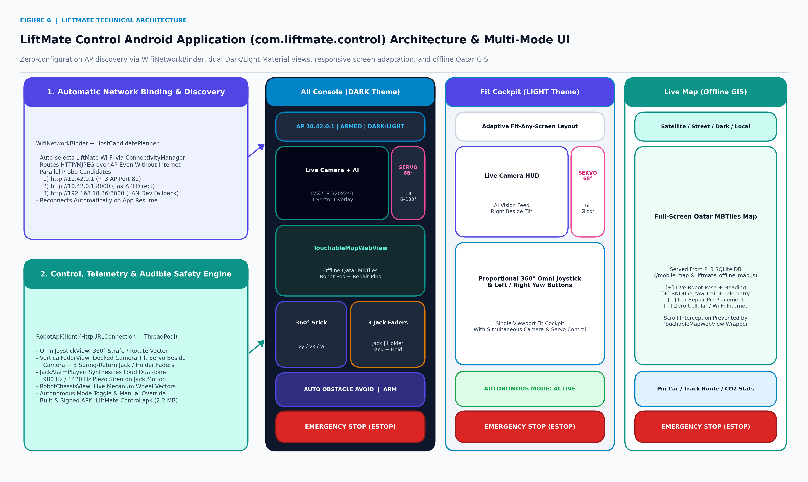

# LiftMate — Autonomous-Capable Omnidirectional Vehicle Recovery & Lifting Robot

<p align="center">
  
</p>

**LiftMate** is a zero-emission, fully offline, four-tier cyber-physical vehicle lifting and roadside recovery platform built around an **Arduino Mega 2560**, **Raspberry Pi 3**, **4-wheel omnidirectional Mecanum chassis**, **8× 12 V dual-stage linear actuators**, **BNO055 9-DOF IMU**, and **Sony IMX219 CSI camera**, operated via a dedicated **native Android application (`LiftMate-Control.apk`)** or a browser-based **Web Control Center**.

> **Full Technical Paper:** Read the complete [**LiftMate Scientific Research Report & Operator Manual**](docs/LiftMate_Scientific_Research_Report.md) with high-resolution electrical schematics, deterministic watchdog flowcharts, Mecanum kinematic derivations, AI vision diagrams, and full troubleshooting guides.

---

## Core Engineering Highlights

| Subsystem | Technical Implementation | Key Capabilities & Safety Bounds |
| :--- | :--- | :--- |
| **Omnidirectional Chassis** | 4× Mecanum Wheels (`FL`, `FR`, `RL`, `RR`) on `D4–D7`, `D26–D29`, `D44–D47` | Holonomic forward/reverse, pure strafing, diagonal motion, in-place rotation, per-wheel calibration & polarity trim |
| **Dual Linear Lift Stage** | 4× `30 mm` Lower Holder Clamps (`D2`, `D22–23`) + 4× `50 N 100 mm` Upper Lifters (`D3`, `D24–25`) | `600 ms` hold-to-run watchdog, `5,000 ms` lower max run, `10,000 ms` upper max run, `980/1420 Hz` audible safety siren |
| **Real-Time MCU Safety** | `RobotJackSafe.ino` @ `115200` bps (`#,CMD,...#` framed UART) | `450 ms` wheel watchdog, hardware `WDT`, non-blocking `I2C 0x29` recovery, BNO055 tilt lock (`8°` warn / `15°` `ESTOP`), lazy D8 servo (`6°–130°`) |
| **Offline Edge AI & Auto** | OpenCV CPU DNN (`MobileNet-SSD` + `YOLOv4-tiny`) + `AutonomousController` (`10 Hz`) | `3`-sector (`LEFT`/`CENTER`/`RIGHT`) hazard grid, `55–125 PWM` autonomous cruise, `0.25 s` pre-turn brake, `0.60 s` evade, `1.8 s` stale-camera pause, instant manual override |
| **Standalone Edge AP** | `liftmate-wifi.service` (`hostapd` + `dnsmasq` + Port `80` proxy) | Zero-internet Wi-Fi AP (`LiftMate` / `12345678`, `10.42.0.1/24`) suppressing `NetworkManager` conflicts |
| **Offline GIS Navigation** | FastAPI + SQLite MBTiles (`qatar_offline.mbtiles`) + `liftmate_routes.db` | Offline Satellite/Street/Dark/Local maps, BNO055 dead-reckoning pose trail, Car Repair Pins |
| **Android Mobile App** | Native Kotlin (`com.liftmate.control`, API `24–35`, `2.2 MB` APK) | Auto Wi-Fi socket binding (`WifiNetworkBinder`), `DARK` & `LIGHT` themes, `All Console` / `Fit Cockpit` / `Live Map` modes, responsive layout |

---

## Live Mobile App, AI Vision & Engineering UI Screenshots

| Android Mobile App — AI Detection HUD & Beside-Camera Servo | Android `Fit Cockpit` — Light Mode & Autonomous Guard |
| :---: | :---: |
|  |  |
| **Autonomous Obstacle Avoidance (`SCAN_ROTATE`)** | **Spare Web Console (`http://10.42.0.1/`) & Offline Map** |
|  |  |

## Visual Engineering Overview

| Electrical Circuitry & Pinout | Autonomous & Safety Flowchart |
| :---: | :---: |
|  |  |
| **Mecanum Kinematics** | **Android App & Multi-Mode UI** |
|  |  |

*(Also see [Figure 5: Offline Dual-Model AI Vision Pipeline](docs/figures/fig5_ai_vision_pipeline.png) and 10 full UI captures inside the [Scientific Research Report](docs/LiftMate_Scientific_Research_Report.md).)*

---

## Quick Start: How to Connect & Operate LiftMate

### 1. Power On & Automatic Robot Startup
1. Verify the **USB cable** between the **Raspberry Pi 3** and **Arduino Mega 2560** is securely connected.
2. Release/twist the physical red **Mushroom E-STOP** switch on the `+12 V` main power rail.
3. Wait `~30–45 s` for the Raspberry Pi 3 `systemd` daemons (`liftmate-wifi.service`, `liftmate-control.service`, `liftmate-camera.service`, `liftmate-port80.service`) to broadcast the hotspot.

### 2. Mobile App Installation & Auto-Connection (Recommended)
1. Install the pre-built APK onto your Android smartphone (`Android 7.0+` / API `24+`):
   ```
   LiftMate-Control-Center/android/LiftMate-Control.apk
   ```
2. Connect your phone to Wi-Fi network **`LiftMate`** using password **`12345678`**.
3. Open **LiftMate Control**. The app automatically binds HTTP/MJPEG traffic over the offline AP (`10.42.0.1`), probes FastAPI endpoints, and connects with zero manual IP entry.
4. Switch seamlessly between **Dark / Light Mode** and **`All Console` / `Fit Cockpit` / `Live Map`** from the top control strip.

### 3. Spare Web Control Center (Any Browser)
1. Connect a laptop, tablet, or backup phone to **`LiftMate`** (`12345678`).
2. Open **`http://10.42.0.1`** (or **`http://10.42.0.1:8000`**) in any browser to access driving, dual linear jack controls with audible safety siren, **Autonomous Obstacle Avoidance**, live AI camera overlays, and offline maps.

---

## Repository Structure

```text
robotcar/
├── README.md                                  # Project overview & operator quick start
├── docs/
│   ├── LiftMate_Scientific_Research_Report.md # Full IEEE-style scientific paper & field manual
│   ├── figures/                               # 6 custom 300 DPI technical diagrams
│   └── screenshots/                           # 10 real Android APK, AI Vision & Web UI captures
├── LiftMate-Control-Center/                   # FastAPI server, firmware, web UI, models & scripts
│   ├── android/LiftMate-Control.apk           # Pre-built signed Android APK (2.2 MB)
│   ├── backend/                               # FastAPI controllers + pi_camera_agent.py
│   ├── config/robot_config.yaml               # Hardware pinout, wheel trim & safety parameters
│   ├── data/                                  # Offline AI weights (MobileNet-SSD, YOLOv4-tiny) & Qatar MBTiles
│   ├── firmware/                              # RobotJackSafe.ino Mega 2560 firmware & backup
│   ├── frontend/                              # Web Control Center + offline Leaflet + /mobile-map
│   ├── scripts/setup_pi_hotspot.sh            # Persistent Raspberry Pi 3 hostapd/dnsmasq installer
│   ├── tests/                                 # Automated pytest backend & controller suite
│   ├── TESTING_GUIDE.md                       # Step-by-step hardware bench & calibration checklist
│   └── WIRING.md                              # Arduino Mega pins, BTS7960 vs L298N, E-STOP specs
└── LiftMate-Android/                          # Native Android Kotlin/Gradle source project
    ├── app/src/main/java/com/liftmate/control/
    ├── app/src/main/res/
    └── app/src/test/java/com/liftmate/control/
```

---

## Developer Setup & Verification

### Backend Installation & Verification (`LiftMate-Control-Center`)
```bash
cd LiftMate-Control-Center
./install.sh
PYTHONPATH=. python3 -m pytest -v tests/
```

### Raspberry Pi 3 Hotspot Setup (Standalone AP Mode)
```bash
sudo bash LiftMate-Control-Center/scripts/setup_pi_hotspot.sh
```

### Android App Build & Unit Tests (`LiftMate-Android`)
Configure `ANDROID_HOME` (or create `LiftMate-Android/local.properties` with `sdk.dir=/path/to/Android/sdk`), then run:
```bash
cd LiftMate-Android
gradle testDebugUnitTest assembleDebug --no-daemon
```

---

## Hardware & Safety Documentation
* **Full Scientific Research Report:** [`docs/LiftMate_Scientific_Research_Report.md`](docs/LiftMate_Scientific_Research_Report.md)
* **Wiring & Driver Current Specifications:** [`LiftMate-Control-Center/WIRING.md`](LiftMate-Control-Center/WIRING.md)
* **Bench Testing & Wheel Calibration Guide:** [`LiftMate-Control-Center/TESTING_GUIDE.md`](LiftMate-Control-Center/TESTING_GUIDE.md)
* **Original Control Center Quick Notes:** [`LiftMate-Control-Center/README.md`](LiftMate-Control-Center/README.md)
