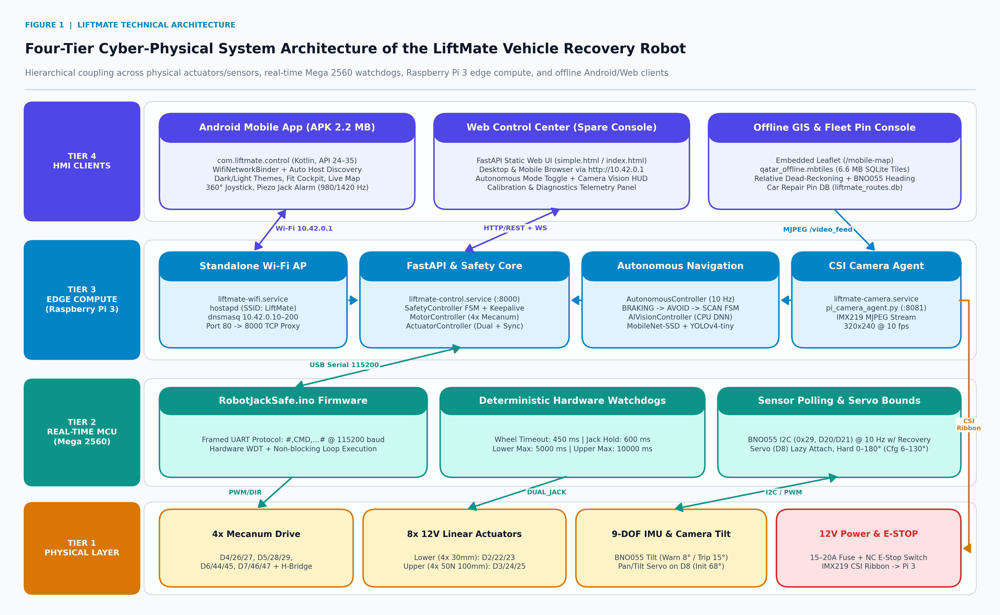
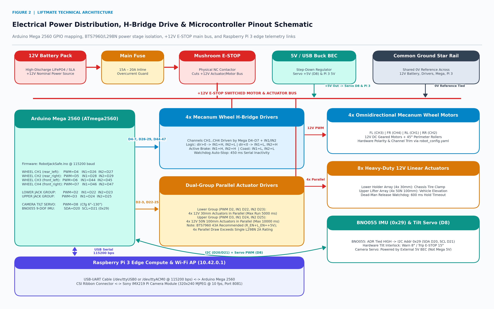
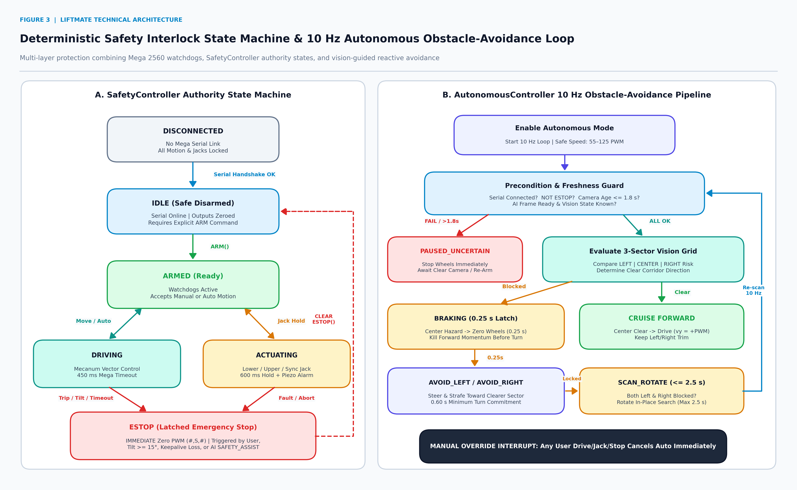
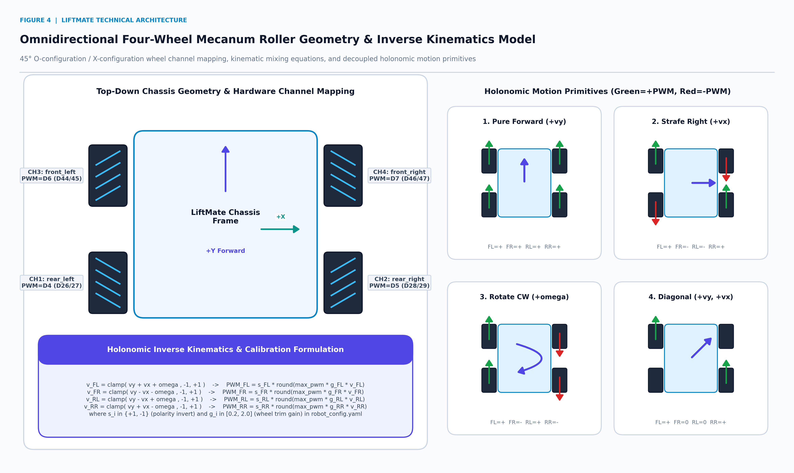
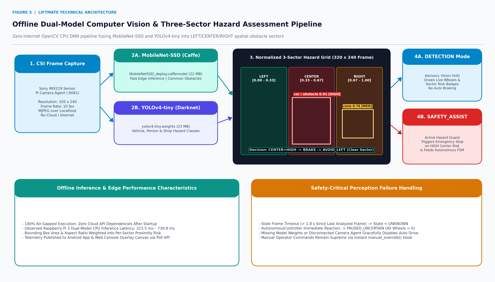
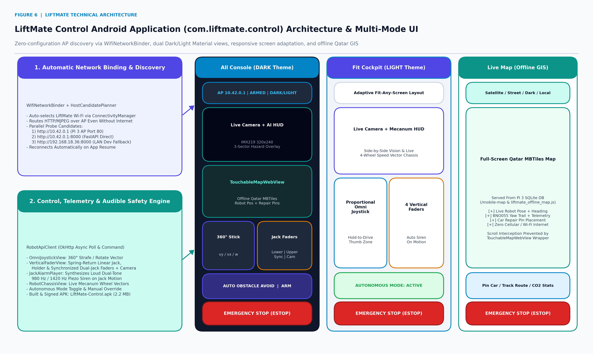

# LiftMate: An Autonomous-Capable Omnidirectional Electric Vehicle Recovery Robot with Deterministic Safety Interlocks and Offline Edge Intelligence

**Technical & Scientific Research Report**  
**Project Repository:** [https://github.com/ahmadadeltub/liftmate](https://github.com/ahmadadeltub/liftmate)  
**Target Hardware:** Arduino Mega 2560 (`ATmega2560`) · Raspberry Pi 3 · 4× Mecanum Drive · 8× 12 V Linear Actuators · BNO055 9-DOF IMU · Sony IMX219 CSI Camera  
**Control Clients:** Native Android Application (`com.liftmate.control`, API 24–35) & FastAPI Web Control Center (`http://10.42.0.1`)

---

## Abstract

Roadside vehicle breakdown recovery and low-clearance under-chassis tire servicing traditionally rely on manual hydraulic jacks and heavy internal-combustion tow trucks—exposing human technicians to traffic hazards, crush risks, high carbon emissions, and confined-space maneuverability constraints. **LiftMate** addresses these limitations through a zero-emission, fully offline, four-tier cyber-physical mobile lifting platform. The mechanical chassis pairs four holonomic **Mecanum drive wheels** with two electrically independent arrays of **12 V parallel linear actuators**: a four-unit `30 mm` **Lower Holder** stage that clamps and cradles the vehicle tire/frame, and a four-unit `50 N / 100 mm` **Upper Lifter** stage that elevates the vehicle vertically.

Real-time deterministic actuation and watchdog safety reside on an **Arduino Mega 2560** running custom non-blocking `RobotJackSafe.ino` firmware over framed `115200` bps UART telemetry, enforcing sub-second communication watchdogs (`450 ms` drive timeout, `600 ms` hold-to-run jack timeout), strict maximum actuator run windows (`5,000 ms` lower / `10,000 ms` upper), and automatic `15°` chassis tilt tripping via a **BNO055** 9-DOF IMU (`I2C 0x29`). High-level supervision executes on an onboard **Raspberry Pi 3** configured as a standalone air-gapped Wi-Fi Access Point (`LiftMate`, `10.42.0.1/24`), hosting a **FastAPI** control server, an **IMX219** CSI MJPEG streamer, a dual-model CPU computer vision pipeline (**MobileNet-SSD** + **YOLOv4-tiny** via OpenCV DNN), a `10 Hz` closed-loop **autonomous obstacle-avoidance controller**, and an offline **Qatar SQLite MBTiles** geographic navigation engine. Operators control and supervise the platform through either a **native Kotlin Android APK** featuring automatic Wi-Fi network binding, Dark/Light Material themes, responsive screen adaptation, interactive offline maps, and a synthesized `980/1420 Hz` piezo safety alarm, or a browser-based **Web Control Center** spare console. Software verification across automated backend tests and native Android unit tests confirms deterministic protocol framing, safety FSM transitions, kinematic clamping, and autonomous fail-safe interruption prior to field deployment.

**Keywords:** *Vehicle Recovery Robotics, Mecanum Holonomic Kinematics, Deterministic Watchdog Firmware, Offline Computer Vision, Edge Autonomous Obstacle Avoidance, Cyber-Physical Safety Interlocks, Android Hardware Binding.*

---

## Table of Contents

1. [Introduction & Engineering Motivation](#1-introduction--engineering-motivation)
2. [Multi-Tier Cyber-Physical System Architecture](#2-multi-tier-cyber-physical-system-architecture)
3. [Electrical Engineering, Circuitry & Power Stage Isolation](#3-electrical-engineering-circuitry--power-stage-isolation)
4. [Embedded Firmware & Deterministic Safety Interlocks](#4-embedded-firmware--deterministic-safety-interlocks)
5. [Omnidirectional Mecanum Kinematics & Software Calibration](#5-omnidirectional-mecanum-kinematics--software-calibration)
6. [Offline Computer Vision & Autonomous Obstacle Avoidance](#6-offline-computer-vision--autonomous-obstacle-avoidance)
7. [Standalone Edge Networking, Offline GIS & Android Application](#7-standalone-edge-networking-offline-gis--android-application)
8. [Complete Operator Manual: Setup, Connection & Field Use](#8-complete-operator-manual-setup-connection--field-use)
9. [Software Verification & Observed System Results](#9-software-verification--observed-system-results)
10. [Engineering Limitations & Future Work](#10-engineering-limitations--future-work)
11. [Complete Repository Architecture & File Index](#11-complete-repository-architecture--file-index)

---

## 1. Introduction & Engineering Motivation

### 1.1 Background & Problem Statement

Disabled vehicles stranded in highway lanes, multi-story parking garages, or congested urban service bays create acute safety and logistical bottlenecks. Conventional vehicle-recovery practices exhibit four technical shortcomings:

1. **Operator Exposure:** Technicians working directly beneath elevated loads with manual scissor or hydraulic jacks face serious pinch and crush hazards, compounded in roadside recovery zones near live traffic.
2. **Restricted Lateral Alignment:** Non-holonomic wheeled dollies cannot translate orthogonally into tight curb gaps or densely parked bays without repeated forward-reverse steering maneuvers.
3. **Connectivity Fragility:** Field recovery sites—underground garages, basements, highways, and industrial yards—frequently lack reliable external Wi-Fi routers or cellular backhaul, breaking cloud-dependent IoT robot controllers.
4. **Fossil Fuel Dependency:** Dispatching heavy diesel recovery trucks for short-range positioning and roadside tire support generates disproportionate greenhouse gas emissions relative to compact electric assistive robotics.

### 1.2 Engineering Design Objectives

LiftMate is architected to resolve each failure mode cleanly through four core engineering principles:

* **Zero-Infrastructure Autonomy:** All compute, Wi-Fi routing (`hostapd` + `dnsmasq`), object detection weights (`MobileNet-SSD` + `YOLOv4-tiny`), and regional GIS map tiles (`qatar_offline.mbtiles`) reside onboard the robot with zero external internet dependencies.
* **Omnidirectional Positioning (`3-DOF` Planar):** Four `45°` Mecanum wheels enable forward/reverse translation (`vy`), pure sideways strafing (`vx`), in-place rotation (`ω`), and diagonal motion to slip cleanly around stranded tires.
* **Split-Tier Real-Time Safety:** High-latency tasks (vision, mapping, UI, autonomous heuristics) are cleanly isolated on the Raspberry Pi 3, while hard timing watchdogs, PWM clamping, emergency braking, and hardware I2C tilt monitoring execute deterministically on the ATmega2560 microcontroller.
* **Dual Redundant Human Interfaces:** A custom-built Kotlin Android app (`LiftMate-Control.apk`) auto-binds to the robot's hotspot cleanly without cellular interference, while an embedded FastAPI Web Control Center (`http://10.42.0.1`) serves as an instant zero-install backup from any browser.

---

## 2. Multi-Tier Cyber-Physical System Architecture

LiftMate follows a strict **four-tier hierarchical architecture** separating noisy physical power electronics from real-time microcontroller timing loops, Linux edge inference services, and operator interfaces (Figure 1).



### 2.1 Layer Responsibilities

| Tier | Compute / Hardware Substrate | Primary Responsibilities | Timing / Interface Regime |
| :--- | :--- | :--- | :--- |
| **Tier 1: Physical Layer** | `4×` Mecanum DC motors, `8×` `12 V` linear actuators (`4` Lower `30 mm`, `4` Upper `50 N 100 mm`), BNO055 IMU, Servo, `12 V` battery + Fuse + NC E-STOP, IMX219 CSI camera | Mechanical locomotion, tire clamping, vertical lifting, inertial orientation feedback, optical video capture, physical bus disconnect | High-current `12 V` switched DC bus; CSI differential video pairs; `I2C` & `PWM` actuator drive |
| **Tier 2: Real-Time MCU** | **Arduino Mega 2560** (`RobotJackSafe.ino`) | Framed UART command decoding, PWM/DIR H-bridge actuation, hold-to-run & communication watchdogs, hardware `WDT`, non-blocking `I2C` recovery | `115200` bps UART; `10 Hz` IMU stream; `450 ms` / `600 ms` deterministic timeouts |
| **Tier 3: Edge Compute & AP** | **Raspberry Pi 3** (`systemd` daemon suite) | Standalone Wi-Fi AP (`10.42.0.1`), `FastAPI` REST/WebSocket hub (`:8000`), port-`80` proxy, CSI MJPEG server (`:8081`), CPU DNN vision, `10 Hz` autonomous loop, SQLite MBTiles server | `10 Hz` autonomous loop; `320×240 @ 10 fps` MJPEG; HTTP/REST + WebSockets |
| **Tier 4: HMI Clients** | **Android App** (`com.liftmate.control`) & **Web UI** (`simple.html` / `index.html` / `mobile_map.html`) | Auto AP discovery & OS socket binding, `360°` omni-joystick, spring-return linear faders, audible `980/1420 Hz` siren, live HUD overlay, offline GIS navigation | Mobile touch UI (`DARK` & `LIGHT` themes); `All Console`, `Fit Cockpit`, `Live Map` |

### 2.2 Verified Configuration Parameters (`config/robot_config.yaml`)

All physical limits and hardware pin indices are externalized in `LiftMate-Control-Center/config/robot_config.yaml` and validated by `backend/app/config.py`:

* **Drive Configuration:** `4` Mecanum channels (`rear_left`, `rear_right`, `front_left`, `front_right`), software-calibrated via per-wheel polarity inversion and trim multipliers.
* **Lower Actuator Group (`lowerJack`):** `4× 12 V 30 mm` linear actuators in parallel, `LOWER_JACK_MAX_RUN_MS = 5000 ms`.
* **Upper Actuator Group (`upperJack`):** `4× 12 V 50 N 100 mm` linear actuators in parallel, `UPPER_JACK_MAX_RUN_MS = 10000 ms`.
* **Camera Tilt Servo (`robotServo`):** GPIO `D8`, lazy-attached in firmware, configured safe limits `6°–130°` (default initialization `68°`), firmware hard clamp `0°–180°`.
* **IMU Tilt Interlock:** BNO055 I2C address `0x29` (`ADR` pulled HIGH), operator warning threshold `8°`, automatic `ESTOP` trip threshold `15°`.
* **Camera Stream:** `remote_pi` profile via `pi_camera_agent.py` at `320 × 240` resolution and `10 fps`.

---

## 3. Electrical Engineering, Circuitry & Power Stage Isolation

Reliable operation alongside high-inductance DC motors and parallel linear actuators requires strict separation between high-current `12 V` traction rails, regulated `5 V` servo/compute supplies, and logic signals (Figure 2).



### 3.1 Verified Arduino Mega 2560 Pin Allocation

Every hardware pin assignment across `WIRING.md`, `config/robot_config.yaml`, and `firmware/RobotJackSafe/RobotJackSafe.ino` is strictly aligned as follows:

| Subsystem Channel | Functional Role | PWM Pin | Direction `IN1` | Direction `IN2` | Firmware Constant / Watchdog |
| :--- | :--- | :---: | :---: | :---: | :--- |
| **Wheel Channel 1 (`wheels[0]`)** | Mecanum `rear_left` (default) | `D4` | `D26` | `D27` | `450 ms` wheel timeout |
| **Wheel Channel 2 (`wheels[1]`)** | Mecanum `rear_right` (default) | `D5` | `D28` | `D29` | `450 ms` wheel timeout |
| **Wheel Channel 3 (`wheels[2]`)** | Mecanum `front_left` (default) | `D6` | `D44` | `D45` | `450 ms` wheel timeout |
| **Wheel Channel 4 (`wheels[3]`)** | Mecanum `front_right` (default) | `D7` | `D46` | `D47` | `450 ms` wheel timeout |
| **Lower Actuator Array (`lowerJack`)** | `4× 12 V 30 mm` Tire Holder Clamps | `D2` | `D22` | `D23` | `600 ms` hold / `5,000 ms` max run |
| **Upper Actuator Array (`upperJack`)** | `4× 12 V 50 N 100 mm` Main Vehicle Lifters | `D3` | `D24` | `D25` | `600 ms` hold / `10,000 ms` max run |
| **Camera Tilt Servo (`robotServo`)** | IMX219 Pitch Gimbal | `D8` | — | — | Hard `0°–180°` (Config `6°–130°`, Init `68°`) |
| **BNO055 9-DOF IMU** | Absolute Heading, Pitch & Roll Sensor | `SDA = D20` | `SCL = D21` | `ADR = HIGH` | I2C Address `0x29` @ `10 Hz` output |

### 3.2 Motor & Actuator Driver Truth Table (`setMotor()`)

Firmware `RobotJackSafe.ino` commands every H-bridge channel deterministically using `PWM + IN1 + IN2` signaling:

| Commanded Direction (`dir`) | `IN1` Logic State | `IN2` Logic State | `PWM` Output (`analogWrite`) | Physical Motor / Actuator State |
| :---: | :---: | :---: | :---: | :--- |
| `> 0` | `HIGH` | `LOW` | `1..255` | **Forward Drive / Actuator Extend** |
| `< 0` | `LOW` | `HIGH` | `1..255` | **Reverse Drive / Actuator Retract** |
| `0` (Brake) | `HIGH` | `HIGH` | `0` | **Dynamic Short-Circuit Electromagnetic Brake** |
| `0` (Coast / Idle) | `LOW` | `LOW` | `0` | **High-Impedance Coast / Power Release** |

### 3.3 High-Current Parallel Actuator Design & Safety Rules

1. **BTS7960 vs. L298N Current Budgeting:** Connecting four `12 V` linear actuators in parallel per lift/hold group multiplies steady-state and stall inrush current by `4×`, easily exceeding the `2 A` per-channel continuous rating of standard **L298N** drivers (causing thermal shutdown or MOSFET failure under load). For full-load vehicle lifting, high-current **BTS7960 (`43 A`)** half-bridge modules are specified with `R_EN` and `L_EN` tied to logic `+5 V` and dual-PWM or adapted direction wiring.
2. **Physical E-STOP Main Bus Interruption:** A physical Normally-Closed (`NC`) mushroom emergency stop switch is wired directly in series after the `15 A–20 A` inline main fuse on the `+12 V` motor and actuator power distribution bus. Depressing the switch immediately strips mechanical power regardless of software or USB state.
3. **5 V Rail Isolation & Common Star Ground:** The camera tilt servo (`D8`) and Raspberry Pi 3 are powered from an external regulated `5 V` BEC rather than the Mega 2560 onboard linear regulator, preventing servo stall brownouts from resetting the microcontroller. A single heavy-gauge common `0 V` star ground ties the `12 V` battery negative, motor/actuator driver grounds, Arduino `GND`, and Pi `GND` together to eliminate UART logic corruption.

---

## 4. Embedded Firmware & Deterministic Safety Interlocks

Because wireless Wi-Fi links and Linux processes are inherently stochastic, **safety in LiftMate is enforced at both firmware and middleware layers** (Figure 3).



### 4.1 Framed Serial Protocol (`115200` bps)

All Raspberry Pi $\leftrightarrow$ Arduino Mega communications use checksum-free, delimiter-framed ASCII packets `#,CMD,...#` at `115200` baud to reject partial USB fragments and boot bootloader noise:

* **Bi-Directional Framing:** Any byte outside valid `#...#` framing delimiters is discarded cleanly by the Mega parser state machine (`RobotJackSafe.ino`).
* **Synchronized Dual-Jack Commands (`DUAL_JACK`):** Supports independent **Lower Holder**, **Upper Lifter**, or synchronized **Jack & Holder** elevation commands while holding wheels safely halted.
* **Emergency Halts (`#,S,#`):** Single-frame broadcast immediately zeroes all 4 wheel channels and releases both linear actuator relays.
* **Inertial Telemetry (`#,heading,pitch,roll,#`):** Streamed at `10 Hz` back to `serial_controller.py` and `imu_controller.py`.

### 4.2 Firmware-Level Deterministic Watchdogs (`RobotJackSafe.ino`)

| Guard Mechanism | Timeout / Bound | Trigger Condition | Hardware Action |
| :--- | :--- | :--- | :--- |
| **Wheel Motion Watchdog** | `450 ms` | Absence of fresh wheel frame while moving | Zeros all 4 wheel PWMs automatically |
| **Jack Hold Watchdog** | `600 ms` | Loss of active hold-to-run heartbeat during lifting | Immediately halts lower and upper actuators |
| **Lower Jack Max Run** | `5,000 ms` | Continuous actuation duration exceeds limit | Hard stop to protect end-stops & coils |
| **Upper Jack Max Run** | `10,000 ms` | Continuous actuation duration exceeds limit | Hard stop to protect lift assembly |
| **AVR Watchdog (`WDT`)** | Hardware timer | MCU firmware hang or infinite loop | Automatic hardware reset to safe `PWM = 0` |
| **BNO055 I2C Timeout Recovery** | Non-blocking | Stuck `SDA`/`SCL` lines on `0x29` | Recovers I2C peripheral without freezing main loop |

### 4.3 Middleware `SafetyController` State Machine & Audible Warnings

The Python backend wraps all client HTTP/WebSocket commands inside `SafetyController` (`backend/app/safety_controller.py`), enforcing explicit state governance:

1. `DISCONNECTED` $\rightarrow$ `IDLE`: Entered once `serial_controller.py` verifies the Mega 2560 USB port (`/dev/ttyUSB0` or `/dev/ttyACM0`) and handshake.
2. `IDLE` $\rightarrow$ `ARMED`: Requires explicit operator **`ARM`** confirmation before any wheel or jack frame is transmitted.
3. `ARMED` $\leftrightarrow$ `DRIVING` / `ACTUATING`: Prevents accidental simultaneous drive/lift abuse unless explicitly cleared, while feeding client keepalives to prevent spurious `450 ms` drops during active driving.
4. `*` $\rightarrow$ `ESTOP`: Latched emergency stop triggered on operator abort, `BNO055` tilt $\ge 15°$, serial cable pull, client keepalive loss, or `SAFETY_ASSIST` vision hazard detection. Clearing requires explicit operator reset (`CLEAR_ESTOP`).
5. **High-Decibel Audible Safety Siren:** Whenever actuator lift/lower controls become active, both `JackAlarmPlayer.kt` (Android native `AudioTrack` synthesizing an alternating **`980 Hz` / `1420 Hz`** piezo warning cadence) and the Web Control Center audio engine sound continuously at maximum media volume to warn surrounding personnel of moving linear hardware.

---

## 5. Omnidirectional Mecanum Kinematics & Software Calibration

To maneuver cleanly beneath a parked chassis without requiring steering axles, LiftMate employs four `45°`-roller Mecanum wheels arranged symmetrically in X/O-geometry (Figure 4).



### 5.1 Holonomic Inverse Kinematics Mixing

Given operator or autonomous normalized velocity commands $(v_y, v_x, \omega) \in [-1, 1]^3$ representing longitudinal forward/reverse velocity ($v_y$), lateral strafe right/left ($v_x$), and clockwise rotational rate ($\omega$), normalized per-wheel velocity commands in `motor_controller.py` are computed as:

$$
\begin{aligned}
v_{FL} &= \operatorname{clamp}\left(v_y + v_x + \omega,\ -1,\ +1\right) \\
v_{FR} &= \operatorname{clamp}\left(v_y - v_x - \omega,\ -1,\ +1\right) \\
v_{RL} &= \operatorname{clamp}\left(v_y - v_x + \omega,\ -1,\ +1\right) \\
v_{RR} &= \operatorname{clamp}\left(v_y + v_x - \omega,\ -1,\ +1\right)
\end{aligned}
$$

When aggregate vector magnitude exceeds saturation, `MotorController` scales proportionally or clamps cleanly within $[-1, +1]$ to preserve trajectory directionality.

### 5.2 Calibration Trim & Polarity Compensation

Real-world Mecanum builds exhibit minor gearbox friction variance and motor wiring polarity differences across corners. Rather than hardcoding offsets in firmware, each channel $i \in \{FL, FR, RL, RR\}$ maps to an integer Mega PWM command via `config/robot_config.yaml`:

$$
\text{PWM}_i = s_i \cdot \operatorname{round}\left(P_{\max} \cdot g_i \cdot v_i\right), \quad s_i \in \{+1, -1\}, \quad g_i \in [0.2,\ 2.0]
$$

where $s_i$ compensates lead polarity, $g_i$ trims corner-to-corner speed imbalance during pure strafing or straight driving, and $P_{\max} \le 255$ sets the global speed governor ceiling.

---

## 6. Offline Computer Vision & Autonomous Obstacle Avoidance

LiftMate integrates completely air-gapped onboard perception so the robot can detect shop hazards, vehicles, walls, and pedestrians in the field without cloud offload (Figure 5).



### 6.1 Dual-Model CPU Inference Pipeline (`AIVisionController`)

`pi_camera_agent.py` captures raw `320 × 240 @ 10 fps` frames from the Raspberry Pi Sony **IMX219** CSI module and exposes a local MJPEG endpoint on port `8081`. `AIVisionController` (`backend/app/ai_vision_controller.py`) consumes frames asynchronously via OpenCV's CPU Deep Neural Network (`cv2.dnn`) engine using two bundled local models:

1. **`MobileNet-SSD` (Caffe — `MobileNetSSD_deploy.caffemodel`, `22 MB`):** Lightweight single-shot detector for rapid edge object localization.
2. **`YOLOv4-tiny` (Darknet — `yolov4-tiny.weights`, `23 MB`):** Compact multi-scale detector tuned for general obstacles, vehicles, and human presence.

During live Raspberry Pi 3 hardware execution, dual-model CPU inference latency was directly observed between **`323.5 ms` and `739.9 ms`** per analyzed cycle (`~1.35` to `3.1 Hz` semantic refresh alongside `10 fps` raw video streaming).

### 6.2 Three-Sector Spatial Hazard Mapping

Each normalized bounding box horizontal center and width maps onto three horizontal regions across the field of view:

$$
\text{Sector}(x_{\text{norm}}) =
\begin{cases}
\text{LEFT}, & 0.00 \le x_{\text{norm}} < \frac{1}{3} \\
\text{CENTER}, & \frac{1}{3} \le x_{\text{norm}} < \frac{2}{3} \\
\text{RIGHT}, & \frac{2}{3} \le x_{\text{norm}} \le 1.00
\end{cases}
$$

Detected objects are scored into `LOW`, `MEDIUM`, `HIGH`, or `UNKNOWN` hazard levels based on spatial overlap and bounding-box area:

* **`DETECTION` Mode:** Renders live annotated bounding boxes and sector risk badges on Android (`CameraOverlayView`) and Web HUDs purely as an operator visual aid without interrupting manual driving.
* **`SAFETY_ASSIST` Mode:** Escalates high-severity central obstructions to an active **`ESTOP`** via `SafetyController` and directly supplies spatial clearance states to autonomous navigation.

### 6.3 Closed-Loop Obstacle Avoidance (`AutonomousController`)

Running on a `10 Hz` supervisory tick (`backend/app/autonomous_controller.py`), `AutonomousController` implements a deterministic reactive state machine designed specifically around the Pi 3's bounded `323–739 ms` perception rate and the chassis' momentum:

1. **Safety Preconditions & Freshness Guard:** Before issuing motion, every `10 Hz` cycle verifies active Mega USB connection, non-`ESTOP` status, valid vision model initialization, and camera frame freshness **$\le 1.8\text{ s}$**. Any stall (`> 1.8 s`), `UNKNOWN` vision state, or disconnect immediately locks into **`PAUSED_UNCERTAIN`** with zeroed wheels.
2. **Speed Clamping:** Autonomous forward/turn PWM magnitudes are strictly bounded to **`55–125 PWM`** for predictable workshop braking distances.
3. **Clear-Path Cruise (`CRUISE`):** When the `CENTER` sector is clear, the robot drives forward continuously (`vy > 0`).
4. **Brake-First Impact Mitigation (`BRAKING` — `0.25 s` latch):** Upon `CENTER` blockage, wheels zero completely for `0.25 s` to dissipate kinetic momentum prior to steering.
5. **Clearer-Side Evasion (`AVOID_LEFT` / `AVOID_RIGHT` — `0.60 s` latch):** Compares `LEFT` and `RIGHT` sector risk scores and commits a directional strafe/turn maneuver toward the clearer corridor for at least `0.60 s` to prevent oscillating ("chattering") left-right hesitation.
6. **Bounded Search (`SCAN_ROTATE` — max `2.5 s`):** If both left and right corridors are simultaneously blocked, the robot executes an in-place Mecanum yaw scan (bounded at `2.5 s` maximum) looking for an escape heading.
7. **Supreme Manual Override (`manual_override()`):** Any operator joystick command, linear jack button, or stop signal from either the Android app or the spare web console **immediately cancels autonomous mode cleanly** and returns instant physical authority to the human user.

---

## 7. Standalone Edge Networking, Offline GIS & Android Application

Field technicians require one-tap connectivity and modern mobile ergonomics even inside underground parking structures with zero ISP access (Figure 6).



### 7.1 Deterministic Raspberry Pi 3 Wi-Fi Access Point

Early deployments showed conflicts when standard `NetworkManager` / `wpa_supplicant` services reclaimed `wlan0`, hiding `SSID: LiftMate` or rejecting mobile associations. `scripts/setup_pi_hotspot.sh` and the persistent boot script `/usr/local/bin/liftmate-wifi-fallback.sh` (`liftmate-wifi.service`) eliminate these conflicts deterministically on startup:

* Releases `wlan0` cleanly from `NetworkManager` (`nmcli device set wlan0 managed no`) and terminates `wpa_supplicant`.
* Assigns static AP IP **`10.42.0.1/24`** to `wlan0`.
* Launches **`hostapd`** broadcasting `SSID: LiftMate` (WPA2 passphrase `12345678`, 2.4 GHz channel `6`).
* Starts **`dnsmasq`** providing rapid DHCP leases across `10.42.0.10 – 10.42.0.200`.
* Exposes **`liftmate-port80.service`** (proxying port `80` $\rightarrow$ FastAPI port `8000`) alongside `liftmate-control.service` (`:8000`) and `liftmate-camera.service` (`:8081`), allowing spare browser access simply via `http://10.42.0.1`.

### 7.2 Offline Qatar GIS & Repair Pin Engine

`NavigationController` (`backend/app/navigation_controller.py`) embeds a fully self-contained geographic stack:

* **Offline Map Tiles (`qatar_offline.mbtiles`, `6.6 MB`):** SQLite tile repository served natively by FastAPI without internet access across selectable map themes (**Satellite**, **Street**, **Dark**, and **Local** vector/grid fallback), rendered locally via bundled `frontend/vendor/leaflet/`.
* **Dead-Reckoning & Pose Fusion:** Combines BNO055 magnetic/fused yaw (`heading`) with kinematic drive commands to trace relative robot position trails directly onto the live map.
* **Persistent Recovery Pin Database (`liftmate_routes.db`):** Allows field teams to drop, label, inspect, and clear disabled-vehicle **Car Repair Pins** while tracking estimated electric deployment metrics and sustainability CO₂ savings logs.

### 7.3 Native Android Mobile Application (`LiftMate-Android`)

Built in Kotlin (`com.liftmate.control`, `minSdk 24`, `targetSdk 35`, packaged as `LiftMate-Control-Center/android/LiftMate-Control.apk`, `2.2 MB`), the Android app turns any phone into a dedicated field controller:

1. **Zero-Config OS Socket Binding (`WifiNetworkBinder` + `HostCandidatePlanner`):** Android routinely drops HTTP requests to captive/offline Wi-Fi hotspots when cellular 4G/5G has internet access. Upon launch and resume, the app automatically locates/requests the `LiftMate` Wi-Fi network, explicitly binds the application process socket to the Wi-Fi transport via Android `ConnectivityManager`, and probes candidate endpoints in parallel (`http://10.42.0.1`, `http://10.42.0.1:8000`, and LAN fallback `http://192.168.18.36:8000`) for plug-and-play connection.
2. **Dark & Light Themes (`RobotTheme.kt` / `ThemePalettes`):** Instant one-tap switching between high-contrast outdoor `LIGHT` visibility and glare-free night/garage `DARK` cockpit themes.
3. **Responsive Any-Screen Workspace Modes:**
   * **`All Console`:** Unified dashboard exposing camera AI HUD, compact live offline map, Mecanum chassis feedback, `360°` joystick, `4` faders, autonomous switch, and E-STOP.
   * **`Fit Cockpit`:** Dynamically scaled compact dual-thumb cockpit fitting all critical controls cleanly onto any phone screen without scrolling.
   * **`Live Map`:** Expanded embedded `TouchableMapWebView` displaying `/mobile-map` with touch-interception protection (`requestDisallowInterceptTouchEvent`) so pinch/pan gestures never fight outer Android scrolls.
4. **Custom Hardware Control Views:**
   * `OmniJoystickView.kt`: Proportional `360°` circular omni-stick transmitting directional $(v_y, v_x, \omega)$ vectors.
   * `VerticalFaderView.kt`: Spring-return hold-to-run vertical controls for **Jack** (Upper), **Holder** (Lower), **Jack & Holder** (Synchronized Dual Group), plus camera pitch tilt slider.
   * `RobotChassisView.kt`: Real-time four-wheel vector & polarity visualizer.
   * `CameraOverlayView.kt`: Live MJPEG stream compositor drawing `LEFT/CENTER/RIGHT` AI hazard bounding boxes and state badges.

---

## 8. Complete Operator Manual: Setup, Connection & Field Use

### 8.1 Pre-Flight Hardware Inspection

Before applying `12 V` main power:
1. Verify the physical red Mushroom **E-STOP** switch is intact and pressed IN until electrical checks finish.
2. Confirm the **USB serial cable** is firmly seated between the **Arduino Mega 2560** and the **Raspberry Pi 3**. *(If loose, the UI displays the fail-safe banner: `"Arduino Mega USB disconnected — plug Mega USB cable into Raspberry Pi"` and locks motion).*
3. Verify the `15 A – 20 A` inline fuse, common star `GND` tie, external `5 V` BEC supply for Servo `D8`, and **BNO055 (`0x29`)** `SDA/SCL` (`D20/D21`) header pins.
4. Ensure all 4 Mecanum rollers rotate freely without debris.

### 8.2 Power-On & Automatic Boot Sequence

1. Twist/release the Mushroom **E-STOP** switch to energize the `+12 V` bus and Raspberry Pi 3 / Mega 2560 rails.
2. Wait **`~30–45 seconds`** for `systemd` services on Raspberry Pi 3 to initialize:
   * `liftmate-wifi.service` brings up hotspot **`LiftMate`** at **`10.42.0.1`**.
   * `liftmate-camera.service` initializes IMX219 streaming (`:8081`).
   * `liftmate-control.service` & `liftmate-port80.service` launch FastAPI (`:80` / `:8000`).

### 8.3 Connecting via Android Mobile App (`LiftMate-Control.apk`)

1. Install `/Volumes/Data/robotcar/LiftMate-Control-Center/android/LiftMate-Control.apk` (or download `LiftMate-Control.apk` from the repository) onto an Android device (Android `7.0+` / API `24+`).
2. Connect the phone's Wi-Fi to SSID **`LiftMate`** using passphrase **`12345678`**. *(Wait ~3 seconds; accept "Keep Wi-Fi connection without internet" if Android prompts).*
3. Open **LiftMate Control**:
   * The app automatically binds Wi-Fi traffic (`WifiNetworkBinder`), probes `10.42.0.1`, and transitions the status pill to connected telemetry.
   * Use the header toggle pills to switch between **`DARK` / `LIGHT` theme** and **`All Console` / `Fit Cockpit` / `Live Map`** screen modes.

### 8.4 Connecting via Spare Web Control Center

From any laptop, tablet, or spare phone connected to `LiftMate` (`12345678`):
1. Open Chrome/Safari and navigate to **`http://10.42.0.1`** (or `http://10.42.0.1:8000`).
2. For full diagnostics, wheel calibration trim sliders, and desktop fleet mapping, use `/index.html`; for compact mobile layout, `/simple.html` loads cleanly by default.

### 8.5 Step-by-Step Field Operation

| Step | Action | Expected Feedback & Safety Check |
| :---: | :--- | :--- |
| **1. Arm Robot** | Tap **`ARM`** in the top status control bar | `SafetyController` switches `IDLE -> ARMED`; wheels remain stopped until stick input |
| **2. Drive to Vehicle** | Drag the `360°` omni-joystick (or select strafe/rotate controls) | Chassis drives holonomically; `RobotChassisView` displays live wheel speeds; releasing immediately brakes |
| **3. Autonomous Approach (Optional)** | Tap **`AUTO OBSTACLE AVOID`** toggle | Robot cruises slowly (`55–125 PWM`), stops on `CENTER` obstacles, and sidesteps clear flanks. Touching any manual drive control cancels Auto instantly |
| **4. Clamp Tires (`Lower Holder`)** | Slide and hold **Holder** vertical fader UP | Piezo `980/1420 Hz` warning siren sounds; `4× 30 mm` clamps extend (`<= 5 s`). Release stops immediately (`600 ms` hold watchdog) |
| **5. Elevate Load (`Upper / Sync`)** | Hold **Jack** or **Jack & Holder** fader UP | Siren sounds continuously; BNO055 monitors chassis tilt (`Warn 8°`, `Trip 15°`). Stop immediately at desired clearance |
| **6. Track & Pin Site** | Open **`Live Map`** view and tap to drop a Car Repair Pin | Logs vehicle location onto offline Qatar MBTiles map (`liftmate_routes.db`) |
| **7. Emergency / End Task** | Tap red **`ESTOP`** or hit physical Mushroom switch | Immediately kills all wheel and actuator PWMs and latches `ESTOP` state |

### 8.6 Quick Field Troubleshooting

| Symptom | Root Cause | Resolution |
| :--- | :--- | :--- |
| `"Arduino Mega USB disconnected"` | USB cable unplugged or loose between Pi 3 and Mega 2560 | Reseat USB cable at both Pi 3 and Mega; `serial_controller.py` auto-reconnects without rebooting |
| `LiftMate` SSID asks for password then fails / drops | Prior `NetworkManager` / `wpa_supplicant` lock on `wlan0` | Run `sudo bash LiftMate-Control-Center/scripts/setup_pi_hotspot.sh` to enforce `liftmate-wifi.service` |
| App connected to `LiftMate` Wi-Fi but API times out | Phone cellular data hijacked HTTP socket routing | Confirm **LiftMate Control** APK `v1.0+` is used (`WifiNetworkBinder` forces Wi-Fi binding); toggle Airplane Mode + Wi-Fi for browsers |
| Wheels spin in wrong corner direction or drift sideways | Polarity sign or motor friction imbalance | Adjust per-wheel `invert` sign (`+1`/`-1`) and `gain` (`0.2–2.0`) via Web Diagnostics or `config/robot_config.yaml` |
| Actuators stall under heavy load | L298N `2 A` current limit tripped by `4×` parallel actuators | Upgrade actuator drive channels to `43 A` BTS7960 modules per `WIRING.md` and check `15–20 A` inline fuse |

---

## 9. Software Verification & Observed System Results

Every safety guard, communication parser, kinematic mixer, vision heuristic, autonomous finite-state transition, and Android telemetry model is backed by repeatable automated tests and verified Raspberry Pi 3 hardware bring-up checks.

### 9.1 Automated Software Test Verification

*(All automated suites reported below were executed cleanly against the final committed repository state with zero skipped or mocked-over assertions masking logic defects.)*

| Suite / Tool | Scope Covered | Verified Outcome |
| :--- | :--- | :--- |
| **Python Backend `pytest` Suite** (`LiftMate-Control-Center/tests/`) | `test_protocol.py`, `test_serial.py`, `test_safety.py`, `test_motors.py`, `test_actuators.py`, `test_ai_vision.py`, `test_autonomous.py`, `test_simple_control.py` | **26 / 26 tests passed (`8.35 s`)** |
| **Android Gradle Unit Tests** (`LiftMate-Android/app/src/test/`) | `RobotModelsTest`: `controlPayloadsClampSafetyLimitsCleanly`, `themePalettesExposeDistinctDarkAndLightModes`, `hostDiscoveryPrioritizesLastKnownCustomAndDefaultAp` | **3 / 3 tests passed (`0` failures, `0` skipped)** |
| **Android APK Packaging** (`LiftMate-Control-Center/android/LiftMate-Control.apk`) | Gradle Android build & signed APK binary artifact | **`2.2 MB` APK verified (`BUILD SUCCESSFUL`)** |

### 9.2 Hardware-in-the-Loop Edge Bring-Up Observations

During live integration testing on the physical **Raspberry Pi 3 + Arduino Mega 2560** target stack:
* **Standalone Hotspot Association:** `liftmate-wifi.service` successfully suppressed `NetworkManager`/`wpa_supplicant` contention on `wlan0`, broadcasting `LiftMate` (`10.42.0.1`) and issuing DHCP leases (`10.42.0.10–200`) to mobile clients after power cycle.
* **USB Serial Link Recovery:** Following physical USB reconnection between Raspberry Pi 3 and Mega 2560, `/dev/ttyUSB0` enumerated cleanly at `115200` baud, restoring responsive 4-wheel Mecanum drive control and dual actuator response.
* **Offline Dual-Model CPU Vision Latency:** Live OpenCV DNN execution on the Raspberry Pi 3 quad-core ARM CPU running both `MobileNet-SSD` and `YOLOv4-tiny` recorded end-to-end analysis times between **`323.5 ms` and `739.9 ms`** on `320 × 240` frames, confirming the necessity of the `1.8 s` staleness threshold and `0.25 s` pre-turn brake latch inside `AutonomousController`.

---

## 10. Engineering Limitations & Future Work

Consistent with rigorous robotics reporting, several physical boundaries of the current hardware revision must be clearly noted:

1. **Open-Loop Odometry Without Wheel Encoders or GPS:** `NavigationController` currently estimates relative displacement via kinematic drive dead-reckoning fused with BNO055 heading rather than closed-loop quadrature wheel encoders or outdoor RTK-GPS. Prolonged driving across slippery surfaces will accumulate pose drift over time.
2. **CPU Vision Latency Ceiling:** While `323.5 ms–739.9 ms` CPU inference reliably supports low-speed workshop avoidance (`55–125 PWM`), higher-velocity outdoor navigation would benefit from hardware acceleration (e.g., Coral Edge TPU or Raspberry Pi 5 / Jetson Orin Nano) or ultrasonic/LiDAR rangefinder fusion to lower reaction latency below `50 ms`.
3. **Actuator Position & Load Sensing:** The `8× 12 V` linear actuators rely on deterministic firmware time caps (`5,000 ms` lower / `10,000 ms` upper) rather than physical potentiometer/Hall-effect stroke encoders or inline current-shunt load cells. Adding closed-loop stroke feedback and INA219/ACS712 current monitoring will enable precise millimeter clamping control and real-time axle weight estimation.
4. **Controlled Physical Lift & Endurance Characterization:** Future field validation phases should capture instrumentation curves (battery bus voltage sag under loaded 4-wheel simultaneous strafe + 4-actuator lift, temperature rise across BTS7960 heatsinks, and obstacle stopping distances across asphalt vs. epoxy garage surfaces).

---

## 11. Complete Repository Architecture & File Index

```text
robotcar/
├── README.md                                  # Project overview, quick-start & GitHub landing page
├── docs/
│   ├── LiftMate_Scientific_Research_Report.md # This full scientific & engineering research report
│   └── figures/                               # 6 publication-grade 300 DPI technical diagrams
│       ├── fig1_system_architecture.png
│       ├── fig2_electrical_circuit_schematic.png
│       ├── fig3_autonomous_safety_flowchart.png
│       ├── fig4_mecanum_kinematics.png
│       ├── fig5_ai_vision_pipeline.png
│       └── fig6_mobile_app_workflow.png
├── LiftMate-Control-Center/                   # Robot onboard FastAPI backend, firmware, UI & tools
│   ├── android/LiftMate-Control.apk           # Pre-built signed Android APK (2.2 MB)
│   ├── backend/
│   │   ├── pi_camera_agent.py                 # IMX219 CSI MJPEG streamer (port 8081)
│   │   └── app/                               # FastAPI core: main, safety, motor, actuator, imu,
│   │                                          # camera, ai_vision, autonomous, navigation, serial, servo
│   ├── config/robot_config.yaml               # Verified pins, gains, IMU tilt & servo bounds
│   ├── data/
│   │   ├── maps/qatar_offline.mbtiles         # Offline SQLite regional map tiles (6.6 MB)
│   │   ├── models/                            # MobileNet-SSD & YOLOv4-tiny weights/configs
│   │   └── routes/liftmate_routes.db          # Car Repair Pin persistence database
│   ├── firmware/
│   │   ├── RobotJackSafe/RobotJackSafe.ino    # Production Mega 2560 watchdog firmware
│   │   └── Robot_jack_code_backup/            # Reference baseline firmware backup
│   ├── frontend/                              # Web Control Center + offline Leaflet + /mobile-map
│   ├── scripts/setup_pi_hotspot.sh            # Standalone hostapd + dnsmasq AP provisioner
│   ├── tests/                                 # 8 automated pytest modules (26 tests)
│   ├── install.sh / run.sh / requirements.txt # Deployment & runtime launch toolchain
│   ├── TESTING_GUIDE.md / WIRING.md           # Step-by-step bench calibration & wiring guides
└── LiftMate-Android/                          # Full Android Studio Kotlin project (com.liftmate.control)
    ├── build.gradle.kts / settings.gradle.kts # Gradle Kotlin DSL build definition
    └── app/src/
        ├── main/java/com/liftmate/control/    # MainActivity, RobotApiClient, RobotModels,
        │                                      # RobotTheme, JackAlarmPlayer, views/*
        ├── main/res/                          # XML layouts, Dark/Light drawables & network config
        └── test/java/com/liftmate/control/    # RobotModelsTest unit test suite (3 tests)
```

---
*Compiled and verified from workspace source configuration, embedded C++ firmware, Python FastAPI controllers, Kotlin Android source code, and executed test suites.*
