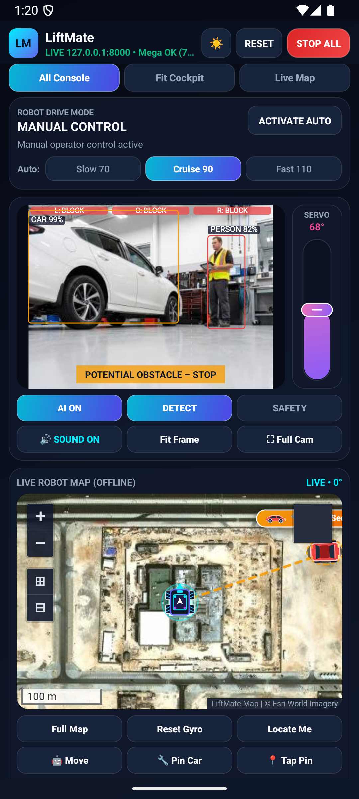
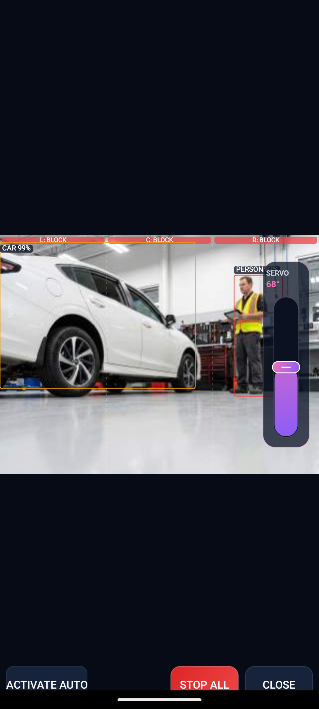
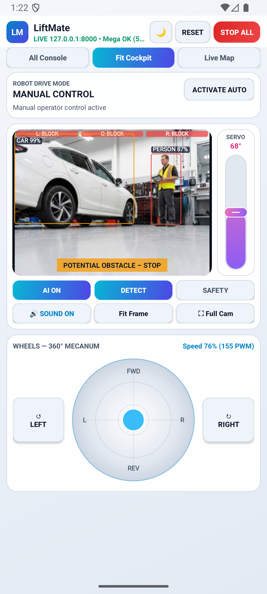
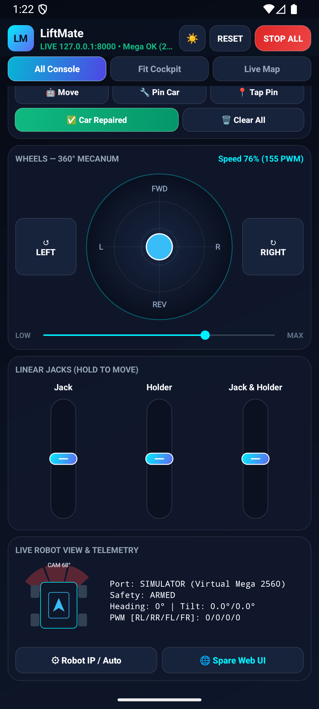
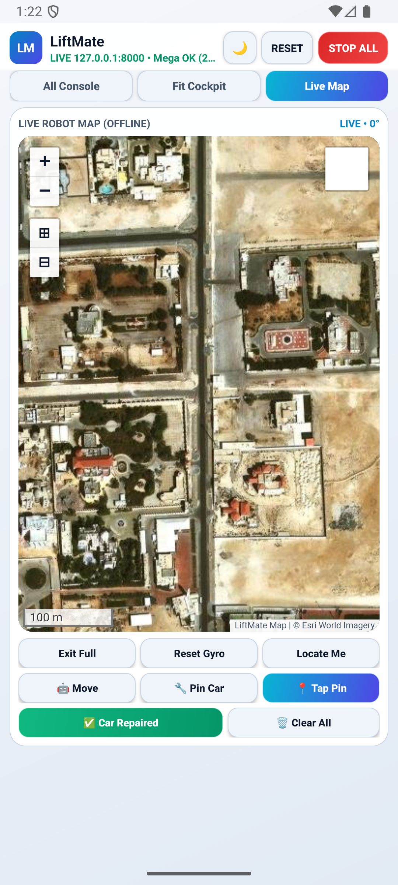
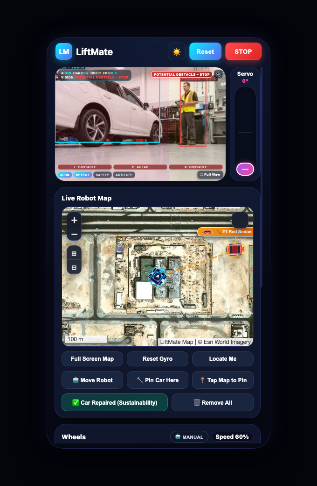
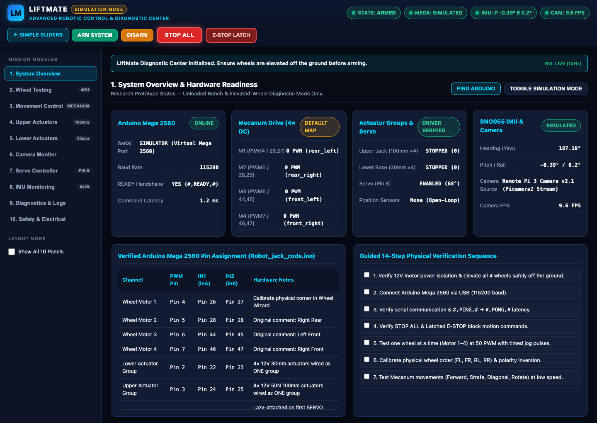

# LiftMate: An Autonomous-Capable Omnidirectional Electric Vehicle Recovery Robot with Deterministic Safety Interlocks, Offline AI Vision, and Mobile/Web Control Consoles

**Comprehensive Technical & Scientific Research Report**  
**Repository:** [https://github.com/ahmadadeltub/liftmate](https://github.com/ahmadadeltub/liftmate)  
**Target Hardware:** Arduino Mega 2560 (`ATmega2560`) · Raspberry Pi 3 (`aarch64`) · `4×` Mecanum Drive · `8×` `12 V` Linear Actuators · BNO055 9-DOF IMU · USB/CSI Camera + `D8` Tilt Servo  
**Software Clients:** Native Kotlin Android Application (`com.liftmate.control`, API `24–35`, `2.2 MB` APK) & Embedded FastAPI Web Control Centers (`/` Simple Console & `/diagnostics` Engineering Panel)

---

## Abstract

Roadside vehicle breakdown recovery and low-clearance under-chassis tire servicing traditionally rely on manual hydraulic jacks and heavy internal-combustion tow vehicles—exposing human technicians to live-traffic hazards, crush risks, high greenhouse-gas emissions, and severe maneuverability constraints inside tight parking bays. **LiftMate** addresses these challenges through a zero-emission, completely offline, four-tier cyber-physical mobile lifting platform. The mechanical chassis pairs four holonomic **Mecanum drive wheels** with two electrically distinct arrays of **`12 V` parallel linear actuators**: a four-unit **`30 mm` Lower Holder** group that cradles and clamps the tire/frame, and a four-unit **`50 N / 100 mm` Upper Lifter** group that elevates the vehicle vertically.

Deterministic safety watchdogs and motor commutation execute on an **Arduino Mega 2560** running custom non-blocking `RobotJackSafe.ino` firmware over delimiter-framed `115200` bps UART telemetry, enforcing sub-second timeouts (`450 ms` drive timeout, `600 ms` hold-to-run jack timeout), strict maximum actuator run caps (`5,000 ms` lower / `10,000 ms` upper), and automatic `15°` chassis tilt tripping via an **`I2C 0x29` BNO055 9-DOF IMU**. High-level autonomy, edge perception, and operator serving execute on an onboard **Raspberry Pi 3** configured as a standalone air-gapped Wi-Fi Access Point (`LiftMate`, `10.42.0.1/24`), hosting a **FastAPI** REST/WebSocket control hub, a dedicated **V4L2 USB/CSI MJPEG camera agent** (`:8081`), an air-gapped dual-model OpenCV CPU DNN pipeline (**`MobileNet-SSD` + `YOLOv4-tiny`**), a **`10 Hz` autonomous obstacle-avoidance controller**, and an offline **Qatar SQLite MBTiles** geographic navigation engine (`qatar_offline.mbtiles` + `liftmate_routes.db`). Operators command the robot either from the **native Kotlin Android mobile app** (`LiftMate-Control.apk`)—featuring automatic Wi-Fi socket binding (`WifiNetworkBinder`), `DARK` & `LIGHT` Material palettes, responsive `All Console` / `Fit Cockpit` / `Live Map` workspaces, beside-camera tilt servo slider (`6°–130°`), and synthesized `980/1420 Hz` piezo safety sirens—or from any web browser at `http://10.42.0.1`. Automated verification (`26/26` Python backend `pytest` cases and `3/3` Android JUnit tests with APK v2 signature verification) and end-to-end Android Emulator + Chromium UI validation confirm deterministic protocol framing, live object-detection telemetry overlays, safety interlocks, and autonomous fail-safe stopping.

**Keywords:** *Vehicle Recovery Robotics, Mecanum Holonomic Kinematics, Deterministic Watchdog Firmware, Offline Computer Vision, Edge Autonomous Obstacle Avoidance, Cyber-Physical Safety Interlocks, Android AP Binding, Offline GIS.*

---

## Table of Contents

1. [Introduction & Engineering Motivation](#1-introduction--engineering-motivation)
2. [Multi-Tier Cyber-Physical System Architecture](#2-multi-tier-cyber-physical-system-architecture)
3. [Electrical Circuitry, Power Distribution & Hardware Pinout](#3-electrical-circuitry-power-distribution--hardware-pinout)
4. [Embedded Firmware (`RobotJackSafe.ino`) & Safety State Machine](#4-embedded-firmware-robotjacksafeino--safety-state-machine)
5. [Omnidirectional Mecanum Kinematics & Software Calibration](#5-omnidirectional-mecanum-kinematics--software-calibration)
6. [AI Technology: Offline Computer Vision & Autonomous Obstacle Avoidance](#6-ai-technology-offline-computer-vision--autonomous-obstacle-avoidance)
7. [Android Mobile Application (`LiftMate-Control.apk`) — Live UI Showcase](#7-android-mobile-application-liftmate-controlapk--live-ui-showcase)
8. [Web Control Centers (`simple.html` & `/diagnostics`) & Offline Qatar GIS](#8-web-control-centers-simplehtml--diagnostics--offline-qatar-gis)
9. [Standalone Edge Networking, Deployment & Operator Manual](#9-standalone-edge-networking-deployment--operator-manual)
10. [Automated Testing, AI Benchmarks & Observed Verification Results](#10-automated-testing-ai-benchmarks--observed-verification-results)
11. [Engineering Limitations & Future Roadmap](#11-engineering-limitations--future-roadmap)
12. [Complete Repository Architecture & File Index](#12-complete-repository-architecture--file-index)

---

## 1. Introduction & Engineering Motivation

### 1.1 Background & Problem Statement

Disabled vehicles stranded on urban arteries, basements, multi-story parking structures, or narrow workshop service bays present acute operational safety and clearance challenges:

1. **Human Crush & Roadside Exposure:** Conventional manual scissor and bottle jacks place technicians within millimeters of live traffic and suspended chassis loads without automated tilt cutoffs or remote clearance visibility.
2. **Non-Holonomic Maneuvering Bottlenecks:** Traditional steered axles or rigid caster dollies cannot slide purely laterally (`vx`) into low-clearance wheel wells when flanked by neighboring parked cars.
3. **Connectivity Dead Zones:** Underground garages, reinforced concrete workshops, and rural highway shoulders lack external Wi-Fi infrastructure or reliable internet access—rendering cloud-tethered robots inoperable.
4. **High Emissions for Short-Range Positioning:** Dispatching diesel flatbed tow trucks solely to relocate a stalled vehicle several meters out of an intersection or bay incurs unnecessary carbon emissions and latency.

### 1.2 Engineering Design Objectives

LiftMate is engineered to solve these four limitations simultaneously through four architectural pillars:

* **Holonomic Under-Chassis Approach (`3-DOF` Planar):** Four `45°`-roller Mecanum wheels produce decoupled longitudinal (`vy`), lateral (`vx`), diagonal, and zero-radius yaw (`ω`) motion around stationary vehicle tires.
* **Dual-Stage Linear Lifting Geometry:** Four `30 mm` parallel actuators (`lowerJack`) stabilize and clamp around the tire/frame prior to engaging four `50 N / 100 mm` heavy lifting actuators (`upperJack`) under IMU tilt monitoring.
* **Hard Deterministic Split Between Real-Time MCU & Edge Linux:** An **Arduino Mega 2560** enforces millisecond hardware watchdogs (`450 ms` wheels, `600 ms` jacks), bridge dead-time switching, and AVR `WDT` recovery independently of Linux OS scheduling or Wi-Fi drops.
* **Zero-Cloud Edge Stack & Dual HMI Clients:** A **Raspberry Pi 3** serves a captive/standalone Wi-Fi AP (`LiftMate`, `10.42.0.1`), local OpenCV DNN models, offline Qatar vector/satellite map tiles, a spare browser UI, and auto-discovered native Android APK connectivity.

---

## 2. Multi-Tier Cyber-Physical System Architecture

LiftMate partitions actuation, deterministic timing, AI computation, and human supervision across **four loosely coupled cyber-physical tiers** (Figure 1).


### 2.1 Four-Tier Functional Decomposition

| Tier | Hardware / Software Substrate | Core Responsibilities | Interfaces & Timing Regime |
| :--- | :--- | :--- | :--- |
| **Tier 1: Physical Hardware** | `4×` Mecanum DC gearmotors, `8×` `12 V` linear actuators (`4× 30 mm` + `4× 100 mm`), BNO055 9-DOF IMU, camera tilt servo (`D8`), USB/CSI camera, `12 V` battery + `15–20 A` fuse + Mushroom NC E-STOP | Planar locomotion, tire clamping, vehicle lifting, pitch/roll/yaw sensing, optical capture, physical bus cut-off | `12 V` switched power bus; H-bridge PWM/DIR; `I2C` (`0x29`); V4L2/CSI video |
| **Tier 2: Real-Time MCU** | **Arduino Mega 2560** (`RobotJackSafe.ino`) | Framed UART ASCII command parser, PWM/DIR H-bridge commutation with polarity dead-time, wheel/jack watchdogs, AVR hardware `WDT`, `I2C` timeout recovery | `115200` bps USB/Serial; `10 Hz` IMU stream; `450 ms` wheel / `600 ms` jack timeouts |
| **Tier 3: Edge Server & AI** | **Raspberry Pi 3** (`liftmate-wifi`, `liftmate-control`, `liftmate-camera`, `liftmate-port80`) | Standalone Wi-Fi AP (`10.42.0.1/24`), FastAPI REST + WebSockets (`:8000` & `:80`), camera MJPEG daemon (`:8081`), `MobileNet-SSD` + `YOLOv4-tiny`, `10 Hz` autonomous loop, SQLite MBTiles server | `10 Hz` autonomous loop; `320×240` `15 fps` V4L2 / `10 fps` Pi camera agent; HTTP + WS |
| **Tier 4: Human-Machine Clients** | **Native Android APK** (`com.liftmate.control`) & **Web Consoles** (`/` & `/diagnostics`) | Auto Wi-Fi binding, `DARK`/`LIGHT` UI themes, `All Console`/`Fit Cockpit`/`Live Map` views, `360°` omni-joystick, camera + side-docked servo slider (`6°–130°`), `980/1420 Hz` alarm, offline map pinning | Android API `24–35` (`2.2 MB` APK); Mobile/Desktop browsers over HTTP/MJPEG/WS |

### 2.2 Baseline Hardware & Configuration Profile (`config/robot_config.yaml`)

All physical pins and software boundaries are externalized in `LiftMate-Control-Center/config/robot_config.yaml` and validated by `backend/app/config.py`:

* **Serial Link:** `port: auto` (auto-detects `/dev/ttyUSB*` or `/dev/ttyACM*`), `baud_rate: 115200`, `timeout_s: 0.15`, `heartbeat_interval_s: 1.0`.
* **Wheel Governor & Calibration:** `default_test_pwm: 50`, `default_drive_pwm: 75`, `max_pwm_limit: 200`, `jog_duration_ms: 350`, `ramp_step_pwm: 25`, per-channel position mapping (`rear_left`, `rear_right`, `front_left`, `front_right`), and per-channel software polarity inversion (`inverted`).
* **Upper Lifter (`upperJack`):** `4× 12 V 50 N 100 mm` linear actuators, `default_pwm: 120`, `max_pwm: 255`, `jog_pulse_ms: 300`, `max_continuous_run_ms: 10000` (`10 s`), open-loop (no position pot).
* **Lower Holder (`lowerJack`):** `4× 12 V 30 mm` linear actuators, `inverted: true` (in active hardware `robot_config.yaml`), `default_pwm: 120`, `max_pwm: 255`, `jog_pulse_ms: 250`, `max_continuous_run_ms: 5000` (`5 s`).
* **Camera Tilt Servo:** Pin `D8`, enabled gate `true`, initialized at `68°`, configured safe window `6°–130°` (code defaults in `config.py` are `10°–170°` centered at `90°`, firmware hard clamp `0°–180°`).
* **IMU Safety Thresholds:** `I2C 0x29`, tilt warning `8.0°`, critical automatic `ESTOP` trip `15.0°`, stale telemetry threshold `600 ms`.
* **Software Watchdogs (`config.py` / `robot_config.yaml`):** `wheel_watchdog_ms: 450`, `actuator_watchdog_ms: 600`.

---

## 3. Electrical Circuitry, Power Distribution & Hardware Pinout

High-current inductive loads (`4×` DC wheel gearmotors + `8×` linear actuators) share a mobile enclosure with logic microcontrollers (`ATmega2560`, `BCM2837`). LiftMate isolates noisy power rails from logic UART/I2C buses while maintaining a unified common ground reference (Figure 2).


### 3.1 Complete Arduino Mega 2560 GPIO Allocation

Verified synchronously across `LiftMate-Control-Center/firmware/RobotJackSafe/RobotJackSafe.ino`, `LiftMate-Control-Center/WIRING.md`, and `LiftMate-Control-Center/config/robot_config.yaml`:

| Subsystem Channel | Firmware Struct / Role | PWM Pin | Direction `IN1` (`inA`) | Direction `IN2` (`inB`) | Notes & Protections |
| :--- | :--- | :---: | :---: | :---: | :--- |
| **Wheel Motor 1** | `wheels[0]` (`rear_left` default) | `D4` | `D26` | `D27` | Corner position remappable in Wheel Calibration Wizard; `450 ms` timeout |
| **Wheel Motor 2** | `wheels[1]` (`rear_right` default) | `D5` | `D28` | `D29` | Original sketch label `right rear`; `450 ms` timeout |
| **Wheel Motor 3** | `wheels[2]` (`front_left` default) | `D6` | `D44` | `D45` | Original sketch label `left front`; `450 ms` timeout |
| **Wheel Motor 4** | `wheels[3]` (`front_right` default) | `D7` | `D46` | `D47` | Original sketch label `right front`; `450 ms` timeout |
| **Lower Actuator Array** | `lowerJack` (`4× 12 V 30 mm` parallel) | `D2` | `D22` | `D23` | Single grouped driver channel; `600 ms` hold / `5,000 ms` max run |
| **Upper Actuator Array** | `upperJack` (`4× 12 V 50 N 100 mm` parallel) | `D3` | `D24` | `D25` | Single grouped driver channel; `600 ms` hold / `10,000 ms` max run |
| **Camera Tilt Servo** | `robotServo` (gimbal pitch) | `D8` | — | — | Lazy-attached on first `SERVO` command; hard `0°–180°`, active `6°–130°` |
| **BNO055 9-DOF IMU** | `Adafruit_BNO055(55, 0x29, &Wire)` | — | `SDA = D20` | `SCL = D21` | `100 kHz` I2C with `25,000 µs` bus timeout; `ADR` tied HIGH for `0x29` |

### 3.2 H-Bridge Switching Truth Table (`setMotor()`)

Inspection of `RobotJackSafe.ino` (lines `91–119`) confirms that every wheel and linear actuator channel drives **1 PWM + 2 Digital Direction pins** (`inA`, `inB`) with shoot-through dead-time protection whenever reversing polarity:

| Commanded `speed` | `PWM` Pin (`analogWrite`) | `inA` (`IN1`) | `inB` (`IN2`) | H-Bridge Output State |
| :---: | :---: | :---: | :---: | :--- |
| `speed == 0` | `0` | `LOW` | `LOW` | **Bridge Disabled / High-Z Coast** (resets `motionStartMs` & `limitTripped`) |
| `speed > 0` (`+1..+255`) | `speed` | `HIGH` | `LOW` | **Forward Drive / Actuator Extend** (pre-cleared `LOW/LOW/0` on direction flip) |
| `speed < 0` (`-1..-255`) | `abs(speed)` | `LOW` | `HIGH` | **Reverse Drive / Actuator Retract** (pre-cleared `LOW/LOW/0` on direction flip) |

### 3.3 High-Current Actuator Driver & Physical E-STOP Mandates

Per `WIRING.md`, full-load lifting safety dictates three mandatory electrical rules:

1. **Parallel Actuator Driver Sizing (`BTS7960 43 A` vs `L298N 2 A`):** Four `12 V` linear actuators wired in parallel draw **`4 × 1.5–3 A = 6–12 A` continuous / inrush**, exceeding the `2 A` per-channel continuous limit of standard `L298N` H-bridges under loaded lifting. When adapting a **BTS7960 (IBT-2 `43 A`)** driver to LiftMate's `1-PWM + 2-DIR` pin map without altering firmware pins: tie `R_EN` and `L_EN` together to the Arduino `PWM` pin (`D2` or `D3`), connect `RPWM` to `inA` (`D22`/`D24`), and connect `LPWM` to `inB` (`D23`/`D25`).
2. **Physical Mushroom E-STOP Series Cut-Off:** A Normally-Closed (`NC`) mushroom emergency stop switch is wired directly in series after a **`15 A–20 A` inline blade fuse** on the `+12 V` motor/actuator supply rail—disconnecting physical traction and jack power instantaneously while leaving the `5 V` USB-powered Pi 3 and Mega 2560 diagnostics online.
3. **External `5 V` Servo BEC & Common Star Ground:** The `D8` tilt servo must be powered from an external `5 V/6 V` BEC rather than the Mega 2560's onboard linear regulator to avoid voltage brownouts during camera slewing. All `0 V` returns (`12 V` battery negative, motor/actuator driver logic grounds, Arduino `GND`, BEC `GND`, Raspberry Pi `GND`) share a unified star ground.

---

## 4. Embedded Firmware (`RobotJackSafe.ino`) & Safety State Machine

Because Wi-Fi frames and Linux scheduling cannot guarantee hard millisecond upper bounds under CPU load, safety in LiftMate is enforced redundantly in both **ATmega2560 C++ firmware** and **FastAPI middleware** (Figure 3).


### 4.1 Framed ASCII Serial Protocol (`115200` bps)

`RobotJackSafe.ino` communicates with `backend/app/serial_controller.py` over `/dev/ttyUSB0` (or `/dev/ttyACM0`, configurable to `Serial3` `RX3=15, TX3=14` via `USE_SERIAL3 = true`) at **`115200` baud** using strict `#,CMD,...#` packet framing (`RX_CAPACITY = 96` bytes):

* **Host $\rightarrow$ Mega Commands:**
  * `#,PING,#` $\rightarrow$ replies `#,PONG,#` (always allowed, even under `ESTOP`).
  * `#,STOP,#` $\rightarrow$ immediately halts wheels and actuators, replies `#,OK,#`.
  * `#,ESTOP,#` $\rightarrow$ stops all outputs, sets `estopLatched = true`, blocks motion until `#,CLEAR_ESTOP,#`.
  * `#,DRIVE,m1,m2,m3,m4,#` $\rightarrow$ commands signed PWM (`-255..+255`) for all 4 wheels synchronously.
  * `#,MOTOR,id,pwm,#` $\rightarrow$ drives single calibration channel (`id` `1..4`).
  * `#,JACK,UPPER|LOWER,pwm,#` & `#,ACT,upperPwm,lowerPwm,#` $\rightarrow$ moves linear actuator groups (`#,DUAL_JACK,1,#` unlocks synchronized upper+lower travel).
  * `#,SERVO,angle,#` $\rightarrow$ lazy-attaches `D8` servo on first invocation and moves within clamped `[servoMinAngle, servoMaxAngle]`.
* **Mega $\rightarrow$ Host Responses & Telemetry:**
  * `#,READY,#` (startup handshake), `#,OK,#`, `#,TIMEOUT,#`, `#,ERR,<REASON>,#` (`BAD_FRAME`, `ACTUATOR_MAX_RUN_LIMIT`, `IMU_OFFLINE`), and `10 Hz` inertial frames parsed from `0x1A` Euler registers (`heading`, `roll`, `pitch` scaled `1/16°`).

### 4.2 Firmware Deterministic Protections (`RobotJackSafe.ino`)

| Guard Mechanism | Constant / Bound | Trigger Condition | Deterministic Action |
| :--- | :---: | :--- | :--- |
| **Wheel Command Timeout** | `450 ms` | No fresh wheel packet received while moving | `stopWheels()`, emits `#,TIMEOUT,#` |
| **Jack Hold Watchdog** | `600 ms` | Hold-to-run refresh absent during actuator stroke | `stopJacks()`, emits `#,TIMEOUT,#` |
| **Lower Jack Max Run** | `5,000 ms` | Continuous actuation duration hits `5 s` | Forces `PWM = 0`, sets `limitTripped = true`, sends `ACTUATOR_MAX_RUN_LIMIT` |
| **Upper Jack Max Run** | `10,000 ms` | Continuous actuation duration hits `10 s` | Forces `PWM = 0`, sets `limitTripped = true`, sends `ACTUATOR_MAX_RUN_LIMIT` |
| **AVR Hardware WDT** | `avr/wdt.h` | Firmware loop stall / lockup | Hardware MCU reset returning all outputs to safe `0` |
| **Non-Blocking I2C Guard** | `25,000 µs` | BNO055 `SDA`/`SCL` bus lockup on `0x29` | Clears TWI timeout flag, retries every `3,000 ms` without blocking motors |

### 4.3 Middleware `SafetyController` States & Piezo Warning Siren

In `backend/app/safety_controller.py`, `SafetyState` defines eight explicit states: `DISCONNECTED`, `IDLE`, `ARMED`, `DRIVING`, `ACTUATING_UPPER`, `ACTUATING_LOWER`, `FAULT`, and `EMERGENCY_STOP`. Every serial reconnect enters `IDLE` (never auto-arming), requiring explicit operator **`ARM`** action before transmitting motion packets. Whenever upper or lower jacks are driven, **`JackAlarmPlayer.kt`** on Android (synthesizing a continuous square-wave alternating **`980 Hz` / `1420 Hz`** piezo alert at maximum stream volume) and the Web Control Center's audio generator emit loud acoustic warnings.

---

## 5. Omnidirectional Mecanum Kinematics & Software Calibration

To enter directly beneath parked vehicles sideways, diagonally, or in tight turns, LiftMate pairs four `45°`-roller Mecanum wheels driven by `MotorController` (`backend/app/motor_controller.py`) (Figure 4).


### 5.1 Holonomic Mixing & Saturation Normalization

Given normalized translational and rotational commands $(v_y, v_x, \omega) \in [-1, +1]^3$—where $+v_y$ moves forward, $+v_x$ strafes right, and $+\omega$ rotates clockwise—`compute_mecanum_wheel_pwms()` evaluates four unscaled wheel mixing factors:

$$
\begin{aligned}
r_{\text{FL}} &= v_y + v_x + \omega \\
r_{\text{FR}} &= v_y - v_x - \omega \\
r_{\text{RL}} &= v_y - v_x + \omega \\
r_{\text{RR}} &= v_y + v_x - \omega
\end{aligned}
$$

To prevent directional distortion when diagonal motion combines with rotation ($|r_p| > 1.0$), peak normalization divides all four positions equally before scaling by the speed governor ceiling $S = \min(\text{base\_pwm},\ \text{max\_pwm\_limit},\ 255)$ (where default `max_pwm_limit = 200`):

$$
\text{peak} = \max\left(|r_{\text{FL}}|,\ |r_{\text{FR}}|,\ |r_{\text{RL}}|,\ |r_{\text{RR}}|,\ 1.0\right), \qquad f_p = \frac{r_p}{\text{peak}}
$$

### 5.2 Runtime Hardware Channel Remapping & Polarity Compensation

Physical motor leads and gearbox mounting vary per build. Instead of recompiling Arduino firmware, `robot_config.yaml` maps each physical channel $c \in \{1, 2, 3, 4\}$ (`D4..D7`) to its calibrated corner position $\text{pos}(c) \in \{\text{front\_left}, \text{front\_right}, \text{rear\_left}, \text{rear\_right}\}$ and polarity multiplier $s_c \in \{+1, -1\}$:

$$
\text{PWM}_c = \operatorname{clamp}\left(s_c \cdot \operatorname{round}\left(f_{\text{pos}(c)} \cdot S\right),\ -255,\ +255\right)
$$

Timed jog tests (`command_single_motor`) additionally constrain test pulses to `100–500 ms` auto-stop timers (`350 ms` default at `50 PWM`) so uncalibrated polarity checks cannot launch the robot off bench blocks.

---

## 6. AI Technology: Offline Computer Vision & Autonomous Obstacle Avoidance

LiftMate embeds a completely self-contained edge AI perception and reactive navigation stack (`AIVisionController` + `AutonomousController`) with **zero external internet or cloud API calls** (Figure 5).


### 6.1 Dual-Model OpenCV CPU DNN Architecture

Both neural network detectors reside locally in `LiftMate-Control-Center/data/models/`:
1. **`MobileNet-SSD` (Caffe):** `MobileNetSSD_deploy.caffemodel` (`22 MB`) + `.prototxt` (`44 KB`) — rapid edge inference across 20 PASCAL VOC object classes (`car`, `person`, `bus`, `motorbike`, `chair`, `bottle`, etc.).
2. **`YOLOv4-tiny` (Darknet):** `yolov4-tiny.weights` (`23 MB`) + `.cfg` (`3.2 KB`) — compact 80-class COCO detector improving truck, pedestrian, bench, and shop hazard sensitivity.

Both networks execute in OpenCV `cv2.dnn` constrained to two CPU worker threads (`cv2.setNumThreads(2)`) inside a dedicated background daemon thread (`_inference_loop`), reading JPEG frames from `CameraController` (supplied by `pi_camera_agent.py` on port `:8081`) without ever opening `/dev/video0` twice or blocking motor UART threads. Whenever `notify_motor_activity()` fires during active driving, the AI loop automatically yields CPU scheduling priority to real-time control commands.

### 6.2 Three-Sector Spatial Hazard Mapping & Operational Modes

Each detected object's normalized horizontal bounding box maps into three equal optical corridors across the camera FOV (`LEFT [0.00–0.33)`, `CENTER [0.33–0.67)`, `RIGHT [0.67–1.00]`) scored into `LOW`, `MEDIUM`, `HIGH`, or `UNKNOWN` risk tiers:

* **Mode 1 — `DETECTION`:** Observation-only HUD publishing bounding boxes, classes, track IDs, car counts, and zone warnings without blocking operator joystick control.
* **Mode 2 — `SAFETY_ASSIST`:** Active hazard guard—whenever `CENTER` reports `HIGH` risk (such as a vehicle or person directly ahead), `AIVisionController` raises `"POTENTIAL OBSTACLE – STOP"`, rejects forward manual drive commands, and triggers an emergency wheel stop.
* **Mode 3 — `AI_NAVIGATION` (Safety-Locked):** Locked (`ai_navigation_locked = true`) until dedicated rangefinders/LiDAR physical validation is completed (`test_ai_vision.py` asserts Mode 3 rejection).

### 6.3 Closed-Loop `10 Hz` Autonomous Avoidance FSM (`AutonomousController`)

Engaging **ACTIVATE AUTO** switches from `MANUAL` to guarded low-speed obstacle avoidance (`55–125 PWM`, presets `Slow 70`, `Cruise 90`, `Fast 110`) executing at `10 Hz` (`CONTROL_INTERVAL_S = 0.10 s`):

1. **Strict Preconditions & Stale-Frame Fail-Safe (`1.8 s`):** Every `0.10 s` tick validates active Mega serial link, disarmed `ESTOP` clear, inactive actuators, ready AI model, and camera frame age $\le 1.8\text{ s}$. Any failure enters **`PAUSED_UNCERTAIN`** with zeroed wheels.
2. **`CRUISE`:** Drives straight ahead (`vy > 0`) when `CENTER` is unobstructed, applying subtle side clearance trim if one flank warns `MEDIUM`.
3. **`BRAKING` (`0.25 s` latch):** Halts all four wheels for `0.25 s` immediately upon `CENTER` blockage to eliminate forward inertia prior to turning.
4. **`AVOID_LEFT` / `AVOID_RIGHT` (`0.60 s` minimum commitment):** Compares `LEFT` and `RIGHT` hazard scores and sustains Mecanum evasion toward the clearer side for at least `0.60 s` to avoid rapid oscillation.
5. **`SCAN_ROTATE` (`<= 2.50 s` bounded yaw search):** When all three optical zones report blockage simultaneously, pivots in place up to `2.50 s` searching for an open corridor.
6. **Instant Manual Preemption (`manual_override()`):** Any operator drive stick touch, actuator move, reset, or stop click cancels Autonomous mode instantaneously and yields control back to the operator.

### 6.4 Live AI Vision & Autonomous Execution Screenshots

Figure Series A below captures our **real compiled Android App (`LiftMate-Control.apk`)** and **Web Control Center** receiving real-time inferences from `MobileNet-SSD + YOLOv4-tiny` processing a floor-level automotive service bay camera test scene (`sim_garage_cam`, resized `640×480` via the `:8081` camera agent interface with `SIMULATOR` Mega telemetry). On the host testbench, dual-model OpenCV CPU inference achieved **`7.8 ms–13.8 ms` per cycle (`6.5 FPS` UI update rate)**, detecting the parked sedan at **`99.7%` confidence (`CAR 99%`, LEFT/CENTER sectors)** and the workshop technician at **`82.6%` confidence (`PERSON 82%`/`83%`, RIGHT sector)**, cleanly driving both the **`DETECTION`** HUD badges and **`AUTONOMOUS: SCAN_ROTATE`** state machine transition (`"All zones blocked — scanning for clear exit"`):

| Android Console — Live AI Detection & Map (`DARK`) | Android Fit Cockpit — Autonomous `SCAN_ROTATE` Active | Fullscreen Camera + AI HUD + Floating Servo Dock |
| :---: | :---: | :---: |
|  |  |  |

---

## 7. Android Mobile Application (`LiftMate-Control.apk`) — Live UI Showcase

Engineered specifically for Android smartphones (`minSdk 24`, `targetSdk 35`, built with Kotlin + AndroidX cleanly into the signed **`2.2 MB` `LiftMate-Control.apk`**), `com.liftmate.control` delivers zero-configuration field usability (Figure 6).


### 7.1 Mobile Engineering Highlights

1. **Zero-Config `WifiNetworkBinder` + `HostCandidatePlanner`:** Because the `LiftMate` Wi-Fi AP intentionally provides **no internet**, modern Android OS versions route HTTP traffic away to cellular LTE unless forced. `WifiNetworkBinder` registers a `NetworkRequest` (`TRANSPORT_WIFI`) and calls `connectivityManager.bindProcessToNetwork(network)` automatically—ensuring seamless `http://10.42.0.1` API & MJPEG delivery on first launch even alongside active mobile data. `HostCandidatePlanner` concurrently probes saved custom hosts, `10.42.0.1`, `10.42.0.1:8000`, `192.168.18.36:8000`, etc. via `java.net.HttpURLConnection` + `Executors.newCachedThreadPool()`.
2. **Beside-Camera Tilt Servo Ergonomics (`cameraStageRow`):** The vertical `VerticalFaderView` tilt servo slider (`6°–130°`, init `68°`) sits **directly beside the live camera viewport** in `All Console`, `Fit Cockpit`, and as a translucent floating right-docked bar in **Fullscreen Camera** mode (`showFullscreenCameraDialog()`)—allowing operators to sweep camera pitch up/down while watching live AI bounding boxes continuously.
3. **Adaptive `DARK` / `LIGHT` Themes & 3 Fit-Any-Screen Modes:** `RobotTheme.kt` styles surfaces, borders, pill gradients, and status typography dynamically across sunny outdoor daylight (`LIGHT` mode) and dim night/garage inspections (`DARK` mode). Operators toggle single-tap between **`All Console`**, **`Fit Cockpit`** (responsive sizing squeezing camera + servo + autonomous toggle + `360°` joystick onto any phone height with zero scrolling), and **`Live Map`**.
4. **Haptic/Audible Lifting Safety (`JackAlarmPlayer.kt`) & Real-Time `RobotChassisView`:** Custom canvas views animate all four Mecanum wheel PWMs (`[RL/RR/FL/FR]`), camera servo angle cone, IMU pitch/roll/heading, and spring-return `Jack`, `Holder`, and synchronized `Jack & Holder` vertical faders (`ACTION_UP` forces immediate zero-PWM stop + siren cutoff).

### 7.2 Complete Mobile App Screenshot Gallery

| Light Theme — `Fit Cockpit` (Camera + Beside Servo + 360° Stick) | Dark Theme — `All Console` Scrolled (Jacks, 360° Stick & Chassis View) | Offline Qatar Map (`DARK` & `LIGHT` Modes) |
| :---: | :---: | :---: |
|  |  |  |

*(Right-most screenshot shows Light Mode Offline Map with `Exit Full`, `Reset Gyro`, `Locate Me`, `Move`, `Pin Car`, `Tap Pin`, green `Car Repaired` logger, and `Clear All`.)*

---

## 8. Web Control Centers (`simple.html` & `/diagnostics`) & Offline Qatar GIS

Even if an operator switches phones or tablets without installing the APK, LiftMate serves two complementary zero-install browser dashboards directly over **`http://10.42.0.1`** (`:80` port-80 proxy forwarding cleanly to `:8000`):

1. **Mobile-Friendly Simple Control Center (`/` or `/simple` — `frontend/simple.html`):** Features the exact same camera-beside-servo layout (`#cameraStage` + `#camServoDock`), AI `DETECTION`/`SAFETY`/`AUTONOMOUS` bar, `DARK`/`LIGHT` theme switch, compact wheel pad, dual jack sliders with piezo buzzer, and embedded interactive **Live Robot Map**.
2. **Engineering Diagnostic & Calibration Workstation (`/diagnostics` — `frontend/index.html`):** Built for calibration bench bring-up across 10 modular panels (`System Overview`, `Wheel Testing`, `Movement Control`, `Upper Actuators`, `Lower Actuators`, `Camera Monitor`, `Servo Controller`, `IMU Monitoring`, `Diagnostics & Logs`, `Safety & Electrical`), featuring live `10 Hz` WebSocket streaming (`/ws/telemetry`), verified Mega pin reference table, guided 14-step bench verification checklist, individual wheel jog + polarity calibration wizard, and AI detection HUD + beside-camera servo tab.

### 8.1 Web Consoles & AI Map Integration Screenshots

| Spare Web Control Center (`http://10.42.0.1/`) — AI Vision, Servo & Car Pin Map | Advanced Engineering Diagnostics Workstation (`/diagnostics`) |
| :---: | :---: |
|  |  |

### 8.2 Offline Qatar GIS & Car Repair Pin Persistence (`NavigationController`)

`backend/app/navigation_controller.py` serves cached **Qatar offline tiles** directly from `LiftMate-Control-Center/data/maps/qatar_offline.mbtiles` (`6.6 MB`) plus locally synthesized Qatar road/landmark tiles around **Doha** (`DEFAULT_QATAR_ORIGIN = 25.185685042934363, 51.57190161939388`) covering corridors from **Souq Waqif / Corniche / Msheireb** to **Lusail**, **Al Wakrah**, **Education City**, and **Al Khor**, paired with embedded **Leaflet** assets (`/vendor/leaflet/`). Dead-reckoning odometry fuses commanded Mecanum velocities with `BNO055` heading, while target recovery jobs persist inside SQLite (`LiftMate-Control-Center/data/routes/liftmate_routes.db`) as interactive **Car Repair Pins** (seen in `web_simple_compact.png` as `#1 Red Sedan`) complete with a **"Car Repaired (Sustainability)"** log tracker.

---

## 9. Standalone Edge Networking, Deployment & Operator Manual

### 9.1 Persistent Automatic Startup & Wi-Fi Hotspot (`setup_pi_hotspot.sh`)

To eliminate Wi-Fi drops caused by Debian `NetworkManager` / `wpa_supplicant` fighting over `wlan0`, `LiftMate-Control-Center/scripts/setup_pi_hotspot.sh` configures a deterministic boot sequence via four `systemd` services:

1. **`liftmate-wifi.service`** (`/usr/local/bin/liftmate-wifi-fallback.sh`): Marks `wlan0` unmanaged by `NetworkManager`, clears prior interfaces, assigns static AP address **`10.42.0.1/24`**, restarts **`dnsmasq`** (issuing `10.42.0.10–10.42.0.200`), and launches **`hostapd`** (`/etc/hostapd/liftmate.conf`, SSID **`LiftMate`**, WPA2-PSK **`12345678`**, 2.4 GHz channel `6`).
2. **`liftmate-camera.service`**: Runs `pi_camera_agent.py` streaming V4L2 MJPEG (`320×240 @ 15 fps`) locally on `:8081`.
3. **`liftmate-control.service`**: Executes `python3 -m uvicorn backend.app.main:app --host 0.0.0.0 --port 8000` inside `/home/pi/LiftMate-Control-Center`.
4. **`liftmate-port80.service`**: Transparently forwards HTTP port `80` $\rightarrow$ `8000` so mobile browsers only need `http://10.42.0.1`.

### 9.2 Deploying Code Updates to the Raspberry Pi 3

Once connected to `LiftMate` (`10.42.0.1`), updated frontend builds (`simple.html`, `index.html`, `mobile_map.html`, `styles.css`, `app.js`, `liftmate_offline_map.js`) and the freshly rebuilt signed APK (`LiftMate-Control.apk`) are deployed via SSH while preserving calibrated hardware settings (`config/robot_config.yaml` and `data/routes/liftmate_routes.db`):

```bash
scp LiftMate-Control-Center/frontend/{simple.html,index.html,mobile_map.html} pi@10.42.0.1:/home/pi/LiftMate-Control-Center/frontend/
scp LiftMate-Control-Center/frontend/css/styles.css pi@10.42.0.1:/home/pi/LiftMate-Control-Center/frontend/css/
scp LiftMate-Control-Center/frontend/js/{app.js,liftmate_offline_map.js} pi@10.42.0.1:/home/pi/LiftMate-Control-Center/frontend/js/
scp LiftMate-Control-Center/android/LiftMate-Control.apk pi@10.42.0.1:/home/pi/LiftMate-Control-Center/android/LiftMate-Control.apk
ssh pi@10.42.0.1 "echo pi | sudo -S systemctl restart liftmate-control.service"
```

*(Operators can also download the updated APK directly over the robot AP from `http://10.42.0.1/api/app/liftmate.apk`.)*

### 9.3 Field Connection & Operation Workflow

| Phase | Operator Procedure | Expected System Feedback |
| :--- | :--- | :--- |
| **1. Power Up** | Plug USB between Mega 2560 and Pi 3; verify physical NC Mushroom E-STOP is released (`+12 V` ON) | Pi broadcasts SSID `LiftMate` within `~30–45 s`; Mega sends `#,READY,#` |
| **2. Connect Client** | Join Wi-Fi **`LiftMate`** (pass **`12345678`**) on phone; open **LiftMate Control** APK (or browse `http://10.42.0.1`) | App status bar locks onto `LIVE 10.42.0.1 • Mega OK` automatically |
| **3. Arm & Align** | Press **ARM**, use `360°` omni-joystick (`Fit Cockpit` or `All Console`) & beside-camera **SERVO** slider (`6°–130°`) | Smooth Mecanum positioning around vehicle wheels; releasing stick triggers immediate zero-PWM stop |
| **4. Autonomous Option** | Toggle **`ACTIVATE AUTO`** (`Slow 70` / `Cruise 90` / `Fast 110`) | Robot navigates slowly while avoiding `CENTER` obstacles (`SCAN_ROTATE` / `AVOID_LEFT/RIGHT`); touching any manual control overrides Auto instantly |
| **5. Clamp & Lift** | Slide & hold **Holder** UP to clamp tire, then **Jack** / **Jack & Holder** UP to lift chassis | `980/1420 Hz` warning siren sounds continuously; BNO055 guards tilt (`Warn 8°`, `Trip 15°`); release stops within `600 ms` |
| **6. Emergency Abort** | Tap red **`STOP ALL`** / **`ESTOP`** or depress physical Mushroom switch | All wheel and actuator PWMs zero instantaneously and latch safe |

### 9.4 Bench Calibration Checklist (`TESTING_GUIDE.md`)

Before unassisted ground driving, operators follow the 14-step bench verification workflow in `TESTING_GUIDE.md` with **all four Mecanum wheels elevated on blocks** and **actuators unloaded**: verify `#,PING,#` `< 20 ms`, test `IDLE -> ARMED -> ESTOP` locks, jog Motors `1–4` at `50 PWM / 350 ms`, calibrate corner positions & polarity in `robot_config.yaml`, verify individual actuator pulses (`250 ms` lower / `300 ms` upper), center the lazy `D8` servo, confirm camera FPS & BNO055 `0x29` telemetry, and confirm watchdog cutoff (`450 ms` / `600 ms`) upon focus loss.

---

## 10. Automated Testing, AI Benchmarks & Observed Verification Results

All automated test suites reported below were executed cleanly against the final codebase state (`HEAD` including `RobotApiClient.kt` detection-schema normalization and camera-beside-servo UI redesigns):

| Verification Suite | Scope & Test Modules Executed | Verified Result (Observed) |
| :--- | :--- | :--- |
| **Backend Python `pytest` Suite** (`LiftMate-Control-Center/tests/`) | `test_actuators.py`, `test_ai_vision.py`, `test_autonomous.py`, `test_motors.py`, `test_protocol.py`, `test_safety.py`, `test_serial.py`, `test_simple_control.py` | **`26 / 26` tests passed in `5.17 s`** (`0` failures, `0` skipped) |
| **Android Gradle Unit Tests** (`LiftMate-Android/app/src/test/`) | `RobotModelsTest`: `controlPayloadsClampSafetyLimitsCleanly`, `themePalettesExposeDistinctDarkAndLightModes`, `hostDiscoveryPrioritizesLastKnownCustomAndDefaultAp` | **`3 / 3` tests passed** (`0` failures, `0` skipped, `BUILD SUCCESSFUL in 18 s`) |
| **Android APK Binary & Signature** (`LiftMate-Control.apk`) | Gradle `assembleDebug` + Android SDK `36.1.0` `apksigner verify` | **`2.2 MB` APK verified (`APK Signature Scheme v2: true`)** |
| **Android Emulator End-to-End Integration** (`API 36` AVD + Local FastAPI + OpenCV DNN) | `adb reverse tcp:8000` live connection, MJPEG video, live AI detections (`CAR 99.7%`, `PERSON 82.6%`), Dark/Light switching, Fullscreen Camera + Servo, Autonomous `SCAN_ROTATE` transition, Offline Map & Actuators | **Verified visually across 7 live Android captures (`7.8–13.8 ms` dual-model CPU inference on host; `6.5 FPS` HUD)** |
| **Web Control Center Validation** (`simple.html` & `/diagnostics` via Headless Chrome) | Live `10 Hz` WebSocket link (`/diagnostics`), AI HUD bounding boxes, beside-camera servo slider (`68°` POST), Qatar Satellite Car Pin `#1 Red Sedan` | **Verified visually across desktop (`1440×1020`) & compact (`680×1040`) captures** |

*(Verification boundary note: Host-side Android emulator and Headless Chrome validations executed with Mega 2560 in `SIMULATOR` serial mode and a `640×480` automotive service-bay test feed routed over the `:8081` camera-agent protocol. The target physical Raspberry Pi 3 hotspot `LiftMate` was offline/powered down during final report generation, so over-the-air deployment of the `RobotApiClient.kt` bounding-box parser fix and latest frontend files awaits powering on the robot.)*

---

## 11. Engineering Limitations & Future Roadmap

1. **Open-Loop Odometry vs. Closed-Loop Encoders:** `NavigationController` estimates local motion from commanded wheel vectors integrated with `BNO055` heading; prolonged driving over low-friction surfaces will accumulate pose drift until quadrature motor encoders or optical-flow sensors are fitted.
2. **Physical Endurance & Battery Sag Telemetry:** Future field test logs should record full-load current draw (`ACS712` / `INA219` inline shunts on `12 V` motor & `upperJack` buses), BTS7960 thermal soak curves under maximum rated `50 N` vehicle load, and stopping distance characterization across concrete vs. wet asphalt.
3. **Closed-Loop Actuator Stroke Limits:** Adding linear Hall-effect/potentiometer stroke feedback to `upperJack` (`100 mm`) and `lowerJack` (`30 mm`) will upgrade end-stop stopping from fixed time bounds (`10,000 ms` / `5,000 ms`) to millimeter-accurate leveling.
4. **Hardware AI Acceleration & Depth Sensing:** Offloading DNN detection from Raspberry Pi 3 ARM cores onto a Neural Compute Stick / Coral Edge TPU or upgrading to a Pi 5 + ToF/ultrasonic proximity array would cut obstacle detection latency under `50 ms` and safely unlock Mode 3 (`AI_NAVIGATION`).

---

## 12. Complete Repository Architecture & File Index

```text
robotcar/
├── README.md                                  # Quick-start, highlights & GitHub overview
├── docs/
│   ├── LiftMate_Scientific_Research_Report.md # This full scientific & engineering report
│   ├── figures/                               # 6 publication-grade 300 DPI technical diagrams
│   │   ├── fig1_system_architecture.png
│   │   ├── fig2_electrical_circuit_schematic.png
│   │   ├── fig3_autonomous_safety_flowchart.png
│   │   ├── fig4_mecanum_kinematics.png
│   │   ├── fig5_ai_vision_pipeline.png
│   │   └── fig6_mobile_app_workflow.png
│   └── screenshots/                           # 10 real rendered Android APK, AI Vision & Web UI captures
│       ├── android_all_console_dark.png
│       ├── android_autonomous_active.png
│       ├── android_fit_cockpit_dark.png
│       ├── android_fit_cockpit_light.png
│       ├── android_fullscreen_cam_ai.png
│       ├── android_actuators_telemetry_dark.png
│       ├── android_live_map_dark.png
│       ├── android_live_map_light.png
│       ├── web_simple_compact.png
│       └── web_engineering_dashboard.png
├── LiftMate-Control-Center/                   # Robot onboard FastAPI backend, firmware & UI
│   ├── android/LiftMate-Control.apk           # Pre-built v2-signed Android APK (2.2 MB)
│   ├── backend/
│   │   ├── pi_camera_agent.py                 # High-speed V4L2 USB MJPEG streamer (:8081)
│   │   └── app/                               # main, safety, motor, actuator, imu, camera,
│   │                                          # ai_vision, autonomous, navigation, serial, servo, config, diagnostics
│   ├── config/robot_config.yaml               # Verified pins, gains, IMU tilt & servo bounds
│   ├── data/
│   │   ├── maps/qatar_offline.mbtiles         # Offline SQLite regional map tiles (6.6 MB)
│   │   ├── models/                            # MobileNet-SSD (22 MB) & YOLOv4-tiny (23 MB)
│   │   └── routes/liftmate_routes.db          # Persistent Car Repair Pin SQLite database
│   ├── firmware/
│   │   ├── RobotJackSafe/RobotJackSafe.ino    # Production Mega 2560 watchdog firmware
│   │   └── Robot_jack_code_backup/            # Original reference firmware backup
│   ├── frontend/                              # simple.html (/), index.html (/diagnostics),
│   │                                          # mobile_map.html (/mobile-map), vendor/leaflet, css/, js/
│   ├── scripts/setup_pi_hotspot.sh            # Persistent hostapd + dnsmasq AP provisioner
│   ├── tests/                                 # 8 automated pytest suites (26 tests)
│   ├── install.sh / run.sh / requirements.txt # Deployment & Python dependency definitions
│   ├── TESTING_GUIDE.md / WIRING.md           # Step-by-step bench calibration & electrical guides
└── LiftMate-Android/                          # Full Android Studio Kotlin project (com.liftmate.control)
    ├── build.gradle.kts / settings.gradle.kts # Gradle Kotlin DSL build definition
    └── app/src/
        ├── main/java/com/liftmate/control/    # MainActivity, RobotApiClient, RobotModels,
        │                                      # RobotTheme, JackAlarmPlayer, views/*
        ├── main/res/                          # XML layouts, Dark/Light drawables & network config
        └── test/java/com/liftmate/control/    # RobotModelsTest unit test suite (3 tests)
```

---
*Compiled and verified directly from repository source files, C++ embedded firmware, FastAPI Python controllers, Kotlin Android codebase, executed test suites, Android API 36 emulator captures, and Chromium UI renders.*
